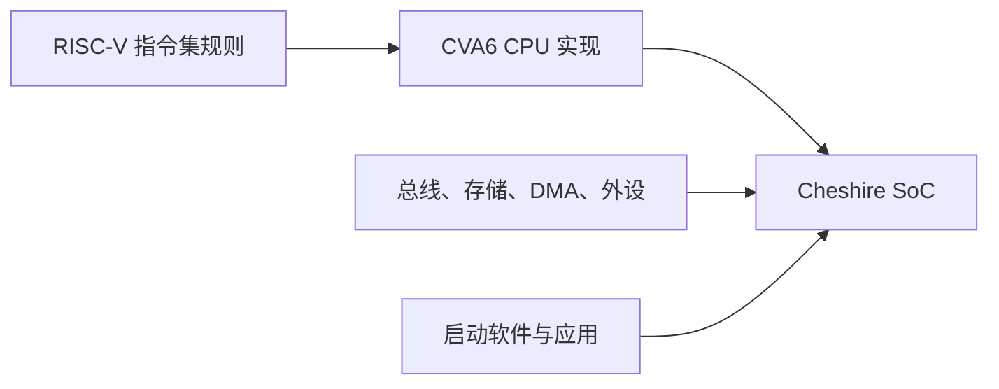
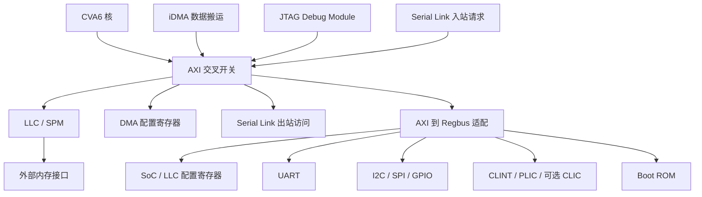
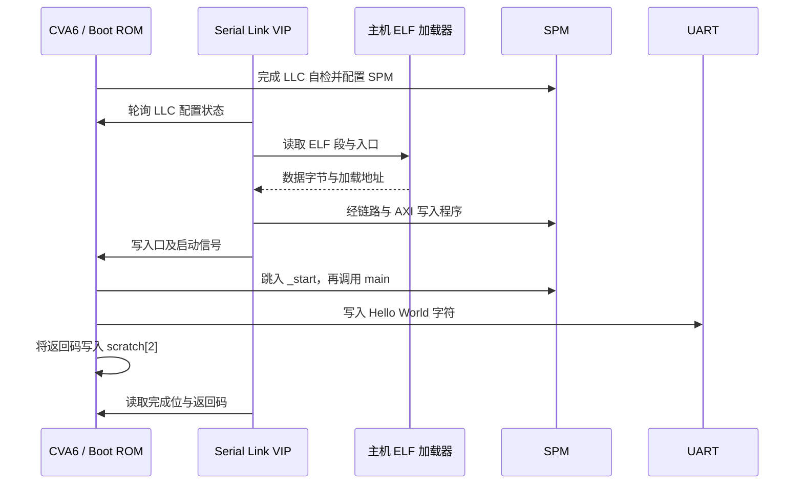
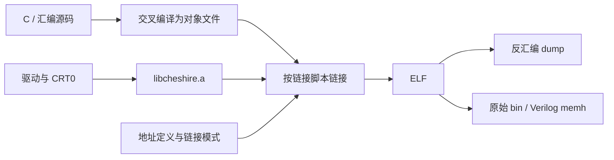
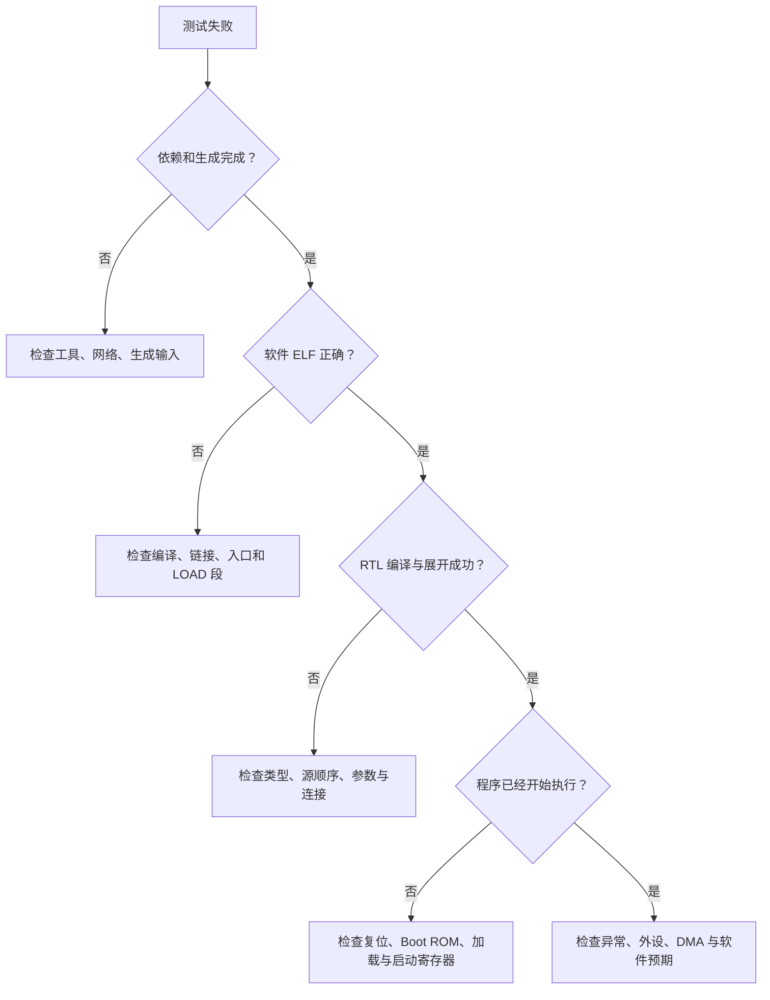

# Cheshire 从零到专家：RISC-V SoC、裸机编程、RTL 仿真与系统集成实战教程

> 本教程基于当前仓库的真实代码编写，适用于 DV365 Cheshire 项目。源码核对基线为 Git 提交 `8abfcc3`，编写日期为 2026 年 10 月 4 日。
>
> 学习主线：先把程序跑起来，再解释每一步为什么成立，最后能够独立修改、验证和集成系统。文中的命令默认在仓库根目录、Bash 终端中执行；明确标注切换目录的地方除外。
>
> “仓库已有通过记录”“本文新增教学示例”“需要进一步接通或验证的功能”会分别说明。平台具备运行 Linux 的能力，但默认六项裸机回归并不验证 Linux 启动、真实 DDR 时序或全部外设。

## 目录

1. [如何使用本教程](#ch00)
2. [先建立基本概念](#ch01)
3. [认识仓库与阅读顺序](#ch02)
4. [理解系统架构与地址地图](#ch03)
5. [从零准备开发环境](#ch04)
6. [跑通第一个 Hello World](#ch05)
7. [建立六项基础回归](#ch06)
8. [编写自己的第一个裸机程序](#ch07)
9. [裸机 C、MMIO 与内存屏障](#ch08)
10. [编译、链接与 ELF 的完整原理](#ch09)
11. [从复位到 main：启动链逐层拆解](#ch10)
12. [时钟、CLINT 与 UART](#ch11)
13. [一维 DMA：原理与完整实验](#ch12)
14. [二维 DMA：步长、矩形与重叠](#ch13)
15. [缓存、SPM 与指令可见性](#ch14)
16. [Serial Link：把总线延伸到远端](#ch15)
17. [异常与中断：完成定时器实验](#ch16)
18. [读懂 SystemVerilog 参数化设计](#ch17)
19. [集成自己的寄存器外设](#ch18)
20. [深入 AXI、Regbus 与总线错误](#ch19)
21. [掌握 testbench 与验证方法](#ch20)
22. [系统调试：从日志追到根因](#ch21)
23. [进阶功能：AXI-RT、CLIC、多核](#ch22)
24. [从 RTL 仿真走向 FPGA](#ch23)
25. [理解 Linux 启动链](#ch24)
26. [性能分析与 DRAMSys](#ch25)
27. [工程化构建、版本与回归](#ch26)
28. [综合项目与专家能力验收](#ch27)
29. [练习答案、术语与命令速查](#ch28)
30. [源码索引与事实核对说明](#ch29)

<a id="ch00"></a>
## 第 0 章：如何使用本教程

### 0.1 适合哪些读者

如果你刚接触 RISC-V，可以先把 Cheshire 看成一台用硬件描述语言搭建的小计算机。它有 CPU、存储器、总线和外设；你编写的 C 程序会被交叉编译成 RISC-V 指令，再交给仿真中的 CPU 执行。

如果你已经写过嵌入式 C，可以重点理解本项目的启动环境、链接脚本、DMA 与缓存关系。如果你已经会写 RTL，可以重点阅读配置结构体、接口类型、互连、验证和系统集成。

本教程并不要求你一开始精通所有技术。第一轮只需要知道某个模块负责什么；第二轮再读接口和时序；第三轮尝试修改并验证。

### 0.2 分阶段学习路线

| 阶段 | 主要章节 | 要完成的事 | 达标证据 |
| --- | --- | --- | --- |
| 入门 | 1～6 | 安装工具，跑通基础回归 | 六个指定 ELF 的结果和日志 |
| 初级开发 | 7～11 | 写裸机程序，理解编译与启动 | 自己的 UART 程序通过仿真 |
| 中级开发 | 12～16 | 使用 DMA、缓存别名和定时器 | 数据检查、保护区检查和中断检查均通过 |
| 高级开发 | 17～21 | 修改参数，集成外设，分析总线 | 能从请求、响应和地址规则解释结果 |
| 系统开发 | 22～26 | 理解高级功能、FPGA、Linux 和性能 | 有明确配置和适用范围的实验报告 |
| 专家实践 | 27～29 | 设计完整实验，建立可重复的证据链 | 他人能依据你的说明复现实验 |

不要把“读完章节”当成唯一目标。每一阶段最好留下三个东西：可重跑的命令、关键日志、你对结果的解释。

### 0.3 两条阅读路线

**快速实践路线**：第 2、4、5、6、7、12 章。先掌握目录、环境、仿真、自定义程序和 DMA。

**完整系统路线**：按章节顺序学习。每完成一个实验，回到源码索引定位对应文件，看看教程描述与代码如何对应。

如果暂时没有商业仿真器，仍可以完成源码阅读、环境检查、软件编译、ELF 分析和参考结果计算。完整 RTL 执行需要实际可用的仿真工具；本仓库的入门主线使用 Xcelium。

### 0.4 命令与代码的三种含义

本文使用以下约定：

- **可执行命令**：针对当前仓库的实际目标与路径，可以在满足环境要求后执行。
- **教学示例**：完整程序或明确标注的代码片段，用来完成实验；新增文件由你按教程创建。
- **扩展方案**：说明需要怎样修改和验证，不能把它直接当成当前仓库已经通过的功能。

代码块里的 `/path/to/...`、许可证服务器、串口设备名、开发板名称等占位内容需要按实际环境替换。`$PWD` 表示当前工作目录；因此在执行项目构建命令之前，应确认你位于仓库根目录。

### 0.5 学习笔记推荐格式

每次实验记录以下内容即可：

```text
实验目标：我要验证什么？
源码版本：Git 提交与本地修改。
硬件配置：默认、AXI-RT、CLIC 或自定义配置。
软件产物：ELF 文件、入口地址、链接模式。
运行方法：完整命令、随机种子、加载方式。
结果证据：返回码、日志、必要的波形。
解释范围：这个结果支持什么结论？
遗留问题：尚未验证哪些条件？
```

这种记录方式会贯穿后续所有章节。

<a id="ch01"></a>
## 第 1 章：先建立基本概念

### 1.1 RISC-V、CVA6 与 Cheshire 分别是什么

**RISC-V 是指令集架构**：它规定 CPU 可以执行哪些指令、寄存器如何使用，以及部分系统行为。可以把它理解为 CPU 与编译器之间共同遵守的语言规则。

**CVA6 是 CPU 核的实现**：它用 RTL 实现指令执行、取指、访存等功能。Cheshire 依赖的 CVA6 版本来自 Bender 锁定的依赖，核心 RTL 不全部放在本仓库的 `hw/` 目录。

**Cheshire 是 SoC 平台**：它把 CVA6 与内存系统、DMA、外设、调试和中断控制器接起来。CPU 核只是一部分，系统是否能启动还取决于存储、地址地图、时钟和软件。



### 1.2 RTL、仿真、综合与 FPGA

RTL 是“寄存器传输级”描述。它写的是电路：哪些寄存器在时钟边沿更新，组合逻辑怎样计算结果，接口怎样握手。

SystemVerilog 文件看起来像代码，但其中的模块和连线通常并不是按文件顺序逐行执行。多个硬件模块同时工作，时钟把它们的状态推进到下一步。

| 环节 | 做什么 | 主要输出 |
| --- | --- | --- |
| RTL 编译 | 解析语法、类型、包和引用 | 仿真器内部的编译结果 |
| 展开 | 根据参数决定实例、连接和位宽 | 确定结构的设计快照 |
| RTL 仿真 | 推进时间，执行硬件与测试环境行为 | 日志、波形、测试结果 |
| 综合 | 把可综合 RTL 转换成电路结构 | 网表 |
| FPGA 实现 | 映射到器件资源，布局布线并检查时序 | bitstream |
| 上板运行 | 在真实时钟、引脚和存储环境中执行 | UART 输出、调试与测量结果 |

仿真中可以用 C++ 读取 ELF，也可以用行为模型模拟内存。综合时，这些测试环境组件并不会成为 FPGA 内部的硬件。

### 1.3 主机与目标机

你运行终端的 Linux 计算机是**主机**。仿真中的 Cheshire 是**目标机**。

主机编译器 `g++` 编译 DPI-C 加载器，生成主机能执行的代码。交叉编译器 `riscv64-unknown-elf-gcc` 编译裸机程序，生成 CVA6 能执行的代码。

```text
主机 Linux
  ├─ make、Bender、Python：准备构建
  ├─ g++：编译仿真器使用的 C++ 代码
  └─ xrun：推进仿真
       └─ Cheshire / CVA6：执行 RISC-V ELF
```

所以，不能在 Linux 终端直接运行 `./sw/tests/helloworld.spm.elf` 来验证这个程序。它不是为主机处理器和主机操作系统生成的可执行程序。

### 1.4 裸机程序与 Linux 程序

裸机程序直接运行在硬件上。没有操作系统替你建立进程、打开文件或管理虚拟内存。本项目提供最小运行时和驱动接口，使 `int main(void)` 能够执行。

普通 Linux 应用通常由操作系统加载，并通过系统调用获得服务。Cheshire 的基础回归运行的是 M 模式裸机程序，与启动 Linux 的软件链不同。

### 1.5 CPU、DMA 与外设的角色

CPU 执行指令，可以读写内存或外设寄存器。DMA 接收搬运任务后，自己发出总线读写请求。UART 等外设则提供通信能力。

用厨房类比：CPU 是厨师，内存是储物区，DMA 是按指令搬运原料的助手，总线是通道，UART 是对外传递消息的窗口。

类比帮助建立直觉，但真实设计中 DMA、CPU 与缓存可能观察到不同的数据副本。后续必须用地址属性和同步规则解释这种情况。

### 1.6 最先需要认识的词

| 术语 | 通俗解释 |
| --- | --- |
| Hart | RISC-V 的硬件执行线程；本项目默认一个内部 hart |
| MMIO | 把硬件寄存器映射到地址空间，使用访存访问它们 |
| AXI | 用于高带宽访存和模块互连的总线协议 |
| Regbus | 用于低成本寄存器访问的内部总线 |
| LLC | 最后一级缓存，本项目可按 way 配置为 SPM |
| SPM | 软件显式管理的片上存储区 |
| ELF | 包含入口、加载段、符号等信息的可执行文件格式 |
| Boot ROM | CPU 复位后执行的内置启动代码 |
| VIP | 验证环境中的接口驱动器和模型 |
| DPI-C | SystemVerilog 调用主机 C/C++ 函数的接口 |

**本章练习**：用自己的话解释“Hello World 在 Xcelium 中执行”时，究竟是谁执行 C 程序对应的指令，谁负责读取 ELF，谁负责输出最终 PASS。

<a id="ch02"></a>
## 第 2 章：认识仓库与阅读顺序

### 2.1 目录地图

```text
cheshire/
├── README.md                 当前项目复现入口
├── Makefile                  根构建入口
├── Makefile.xcelium           Xcelium 专用流程
├── cheshire.mk                可复用的构建片段
├── Bender.yml                硬件依赖和源文件组
├── Bender.lock               硬件依赖锁文件
├── pyproject.toml / uv.lock   Python 工具依赖
├── hw/
│   ├── cheshire_pkg.sv        配置、地址规则、派生参数
│   ├── cheshire_soc.sv        SoC 模块连接
│   ├── cheshire.rdl           系统地址描述
│   ├── regs/                 SoC 寄存器描述与生成结果
│   ├── bootrom/              启动源码和 ROM RTL
│   └── include/cheshire/     接口类型宏
├── sw/
│   ├── sw.mk                 软件编译、链接和镜像规则
│   ├── include/              参数、寄存器和驱动头文件
│   ├── lib/                  CRT0、驱动和辅助库
│   ├── link/                 链接脚本和地址定义
│   ├── tests/                裸机测试
│   ├── boot/                 ZSL、设备树、烧写程序
│   └── deps/                 printf、CVA6 SDK 子模块
├── target/
│   ├── sim/                  testbench、DPI、仿真器脚本
│   └── xilinx/               FPGA 顶层、约束和构建脚本
├── util/                     ROM 生成、OpenOCD 等工具
└── docs/                     架构与目标文档
```

`.bender/`、`.venv/` 和大量构建输出是本地目录。仓库中没有出现某个生成文件，不一定意味着源码缺失；要先确认它应该从哪里生成。

### 2.2 四类文件来源

| 类别 | 示例 | 应怎样取得 |
| --- | --- | --- |
| 主仓库源码 | `hw/cheshire_soc.sv` | Git 克隆 |
| 硬件依赖 | CVA6、AXI、iDMA | Bender 按锁文件检出 |
| 软件子模块 | `sw/deps/printf` | Git 子模块初始化 |
| 生成文件与外部模型 | 寄存器 RTL、Flash 模型 | Make 生成或按规则下载 |

不要把 Git 子模块和 Bender 依赖混为一谈。`git submodule update` 不能替代 `bender checkout`。

### 2.3 推荐的源码阅读顺序

第一轮先读 [Hello World](sw/tests/helloworld.c)，它只涉及读取频率、初始化 UART 和输出字符串。接着读 [软件构建规则](sw/sw.mk) 与 [SPM 链接脚本](sw/link/spm.ld)，理解 ELF 如何产生。

第二轮读 [仿真顶层](target/sim/src/tb_cheshire_soc.sv)、[fixture](target/sim/src/fixture_cheshire_soc.sv)、[VIP](target/sim/src/vip_cheshire_soc.sv)，理解程序如何装进目标系统。

第三轮读 [Boot ROM](hw/bootrom/cheshire_bootrom.S)、[CRT0](sw/lib/crt0.S)、[配置包](hw/cheshire_pkg.sv) 和 [SoC 顶层](hw/cheshire_soc.sv)，将运行路径对应到硬件。

最后再进入 Bender 依赖，阅读 CPU、缓存、互连和 DMA 的实现。这样每次深入都带着具体问题，阅读效率更高。

### 2.4 用搜索建立自己的导航

```bash
rg --files hw sw target docs
rg -n 'DefaultCfg|gen_axi_out|get_llc_size' hw/cheshire_pkg.sv
rg -n 'slink_elf_run|slink_wait_for_eoc' target/sim/src/vip_cheshire_soc.sv
rg -n 'scratch\[2\]|boot_next_stage' hw/bootrom sw/lib
rg -n 'CHS_SW_FLAGS|chs_sw_ld_elf_rule' sw/sw.mk
```

搜索结果中最有价值的是：定义在哪里、调用在哪里、数据由谁写入、由谁读出。只找到名字还不够，要把关系连起来。

<a id="ch03"></a>
## 第 3 章：理解系统架构与地址地图

### 3.1 从数据流看硬件结构



这张图突出教学主线，省略 VGA、USB、总线错误单元和部分适配器。更完整的结构图见 [项目架构图](docs/img/arch.svg)。

CPU、DMA、Debug Module 等能够主动产生请求，称为请求发起方；内存、寄存器外设等接收请求并响应，称为目标方。源码也使用 manager/subordinate 或 mst/slv 命名。

### 3.2 当前默认配置

准确默认值以 [DefaultCfg](hw/cheshire_pkg.sv) 为准。

| 配置项 | 当前值 | 含义 |
| --- | ---: | --- |
| `NumCores` | 1 | 单核基础配置 |
| `AddrWidth` | 48 | AXI 地址信号宽度 |
| `AxiDataWidth` | 64 | AXI 每个完整数据拍有 8 字节 |
| `AxiMstIdWidth` | 2 | 进入主交叉开关前的请求 ID 宽度 |
| `RtcFreq` | 32768 | 软件看到的参考时钟频率 |
| `LlcSetAssoc` | 8 | LLC 的 way 数 |
| `LlcNumLines` | 256 | 每个 way 的 line 数 |
| `LlcNumBlocks` | 8 | 每条 line 的数据块数 |
| `DmaConfEnableTwoD` | 1 | 二维 DMA 开启 |
| `AxiRt` / `Clic` / `IrqRouter` | 0 / 0 / 0 | 默认关闭 |
| `BusErr` | 1 | 总线错误报告功能开启 |

默认配置还启用了 Boot ROM、UART、I2C、SPI、GPIO、DMA、Serial Link、VGA 和 USB。**参数启用不等于外部接口已在当前 fixture 中完整驱动和验证**。例如基础仿真 fixture 将 USB 时钟接为常量；六项回归没有验证 USB 通信。

### 3.3 64 位 CPU、48 位地址、64 位数据不是一回事

64 位 CPU 指通用寄存器和相关执行能力的位宽。48 位 AXI 地址表示总线地址线宽度。64 位 AXI 数据表示完整数据拍的宽度。

它们回答的是不同问题：CPU 怎么计算、总线能表达多大的地址、每拍能传多少数据。不能因为 CPU 是 RV64，就推断每个外设寄存器都是 64 位；本项目 Regbus 的数据宽度是 32 位。

### 3.4 常用地址地图

| 模块 | 起始地址 | 首次学习时的用途 |
| --- | --- | --- |
| Debug 区域 | `0x00000000` | 调试 ROM 与相关逻辑 |
| DMA 配置 | `0x01000000` | 提交 DMA 搬运任务 |
| Boot ROM | `0x02000000` | CPU 复位入口区域 |
| CLINT | `0x02040000` | `mtime`、定时器、软件中断 |
| IRQ Router | `0x02080000` | 可选中断路由 |
| AXI-RT 配置 | `0x020C0000` | 可选流量调节 |
| SoC 寄存器 | `0x03000000` | scratch、频率、功能与容量 |
| LLC 配置 | `0x03001000` | SPM / 缓存配置 |
| UART | `0x03002000` | 字符输出 |
| I2C | `0x03003000` | EEPROM 等外设访问 |
| SPI Host | `0x03004000` | Flash / SD Card 访问 |
| GPIO | `0x03005000` | 通用数字 IO |
| Serial Link 配置 | `0x03006000` | 串行链路控制 |
| VGA 配置 | `0x03007000` | 图像输出控制 |
| USB 配置 | `0x03008000` | OHCI 相关控制 |
| 总线错误单元 | `0x03009000` | 错误报告区域起点 |
| PLIC | `0x04000000` | 平台外设中断 |
| CLIC | `0x08000000` | 可选核心局部中断控制器 |
| 普通 SPM | `0x10000000` | 片上程序与数据 |
| 非缓存 SPM 别名 | `0x14000000` | 绕过 CPU 缓存属性访问 SPM |
| 外部内存 | `0x80000000` | DRAM 链接模式入口 |
| 默认 Serial Link 出站窗口 | `0x100000000` | 访问远端低 32 位地址空间 |

这些地址能在 [SystemRDL 地址描述](hw/cheshire.rdl)、[RTL 地址包](hw/cheshire_addrmap_pkg.sv) 和 [链接地址定义](sw/link/cheshire_addrs.ldh) 中对应起来。外设没有实例化时，对应保留地址不代表存在可使用的硬件。

### 3.5 最容易混淆的三种“大小”

必须区分：**地址空间保留窗口**、**实际硬件容量**、**软件链接时声明的容量**。

默认 LLC/SPM 的实际容量由代码计算：

```text
容量 = way 数 × 每 way 的 line 数 × 每 line 的 block 数 × 每 block 字节数
     = 8 × 256 × 8 × (64 / 8)
     = 131072 字节
     = 128 KiB
```

但 `hw/cheshire.rdl` 为普通 SPM 声明了 64 KiB 的最低软件内存范围，生成的链接脚本也采用这个值。架构文档中的 SPM 地址保留窗口则为 64 MiB。它们不能互相替换。

| 对象 | 默认硬件或映射情况 | 当前链接脚本声明 |
| --- | --- | --- |
| 普通 SPM | 默认实际容量 128 KiB | 64 KiB |
| 非缓存 SPM | 同一块 SPM 的别名，实际有效长度由硬件容量决定 | 声明 64 MiB 的区域窗口 |
| 外部内存 | 默认出口地址范围为 2 GiB | DRAM 链接区域为 8 MiB |

程序能够链接，只说明节区放进了链接脚本给出的范围。访问能否成功，还取决于实际硬件译码和存储模型。

### 3.6 地址区域属性

项目文档使用 C、I、E 标识：

- C：可缓存，CPU 可以将数据保留在缓存中。
- I：幂等，重复的相同访问不会带来额外的设备副作用。
- E：可执行，可以从该区域取指。

MMIO 寄存器可能有读清零、写触发等副作用，所以不能像普通 RAM 那样随意缓存或重复读取。CVA6 的区域属性由 `gen_cva6_cfg()` 配置，单纯添加一条总线地址规则并不会自动解决 CPU 侧的属性问题。

**本章练习**：为什么 `0x10000000` 和 `0x14000000` 的地址不同，却不表示两块独立 RAM？为什么一个 70 KiB 的程序可能在当前 SPM 链接脚本下失败，尽管默认硬件容量是 128 KiB？

<a id="ch04"></a>
## 第 4 章：从零准备开发环境

### 4.1 先明确必需工具

| 工具 | 职责 | 基础回归是否需要 |
| --- | --- | --- |
| Git | 获取主仓库和子模块 | 是 |
| GNU Make | 调度生成、编译和链接 | 是 |
| Bender | 管理硬件 IP 与源文件顺序 | 是 |
| Python ≥ 3.11 | 运行寄存器和模板工具 | 是 |
| RISC-V ELF 工具链 | 编译目标程序 | 是 |
| 主机 G++ | 编译 DPI-C 代码 | 是 |
| Xcelium | RTL 编译、展开和仿真 | 本教程主线需要 |
| `dtc` / `sgdisk` | 设备树与 GPT 镜像 | 按需 |
| Vivado / OpenOCD / GDB | FPGA 与上板调试 | 按需 |
| CMake / SystemC | DRAMSys 相关构建 | 按需 |

仓库 README 已记录一组通过组合：Bender 0.32.1、Python 3.11.16、xPack GCC 15.2.0-1、Xcelium `26.03-a071`。这是复现参考，并不表示其他版本一定不兼容。

### 4.2 克隆与准备子模块

如果你已经在当前项目目录中，跳过克隆，只初始化需要的子模块。

```bash
git clone https://github.com/dv365lab/dv365-cheshire.git
cd dv365-cheshire
git submodule update --init --recursive sw/deps/printf
```

`printf` 为裸机输出提供轻量格式化库。基础回归不要求初始化 `sw/deps/cva6-sdk`；它用于后续 Linux 镜像构建。

```bash
git status --short
git rev-parse --short HEAD
test -s sw/deps/printf/printf.c
```

保留 `Bender.lock` 与 `uv.lock`。它们分别帮助固定硬件与 Python 依赖。

### 4.3 安装 Linux 基础命令

Ubuntu / Debian 系列：

```bash
sudo apt-get update
sudo apt-get install -y \
  git make gcc g++ curl wget unzip tar xz-utils binutils util-linux ca-certificates
```

Rocky / RHEL 8 系列：

```bash
sudo dnf install -y \
  git make gcc gcc-c++ curl wget unzip tar xz binutils util-linux ca-certificates
```

需要 GPT 镜像或设备树时再安装：

```bash
# Ubuntu / Debian。
sudo apt-get install -y gdisk device-tree-compiler

# Rocky / RHEL。
sudo dnf install -y gdisk dtc
```

`flock` 来自 `util-linux`，构建规则用它避免部分生成任务同时修改同一组输出。

### 4.4 创建 Python 环境

推荐按项目锁文件恢复依赖。已有 `uv` 时直接执行下面第二组命令。

```bash
curl -LsSf https://astral.sh/uv/install.sh -o /tmp/cheshire-uv-install.sh
sh /tmp/cheshire-uv-install.sh
export PATH="$HOME/.local/bin:$PATH"
```

```bash
uv python install 3.11
uv sync --locked --python 3.11
source .venv/bin/activate

python --version
python -c 'import hjson, mako, yaml; print("Python dependencies OK")'
peakrdl --version
peakrdl --help
```

没有 uv，但已有 Python 3.11 时，可以走 pip 路径：

```bash
python3.11 -m venv .venv
source .venv/bin/activate
python -m pip install .
```

两种方式选择一种即可。pip 安装会使用 `pyproject.toml` 的声明，不按 `uv.lock` 锁定解析结果。每次新开终端要重新激活环境。

项目的 Python 依赖用于构建工具，并不意味着 Cheshire CPU 在运行 Python。

### 4.5 安装固定版本 Bender

下面沿用仓库 README 的 Linux x86_64 发布包与校验值。

```bash
chs_tools_dir="$HOME/.local/opt/cheshire"
mkdir -p "$chs_tools_dir" "$HOME/.local/bin"

curl -fL --retry 3 \
  https://github.com/pulp-platform/bender/releases/download/v0.32.1/bender-x86_64-unknown-linux-gnu.tar.xz \
  -o "$chs_tools_dir/bender-0.32.1.tar.xz"

printf '%s  %s\n' \
  59a36723b056a06b266dc68d4ceedcd0aa17a1c096e8c2ea512af264ff6a13f6 \
  "$chs_tools_dir/bender-0.32.1.tar.xz" | sha256sum -c -

tar -xJf "$chs_tools_dir/bender-0.32.1.tar.xz" -C "$chs_tools_dir"
ln -sfn "$chs_tools_dir/bender-x86_64-unknown-linux-gnu/bender" \
  "$HOME/.local/bin/bender"
export PATH="$HOME/.local/bin:$PATH"
bender --version
```

其他主机架构应使用相应发布包。已有兼容版本时，无需重复安装。

### 4.6 安装 RISC-V 交叉工具链

本项目的软件 Makefile 默认寻找 `riscv64-unknown-elf-*`。仓库实测使用的 xPack 包提供 `riscv-none-elf-*`，所以需要建立别名。

```bash
chs_tools_dir="$HOME/.local/opt/cheshire"
mkdir -p "$chs_tools_dir" "$chs_tools_dir/riscv-bin"

curl -fL --retry 3 \
  https://github.com/xpack-dev-tools/riscv-none-elf-gcc-xpack/releases/download/v15.2.0-1/xpack-riscv-none-elf-gcc-15.2.0-1-linux-x64.tar.gz \
  -o "$chs_tools_dir/xpack-riscv-none-elf-gcc-15.2.0-1-linux-x64.tar.gz"

printf '%s  %s\n' \
  aaaa8060c914851a3e5ee1ba82cc3d6f80972f90638a05c6e823a37557a33758 \
  "$chs_tools_dir/xpack-riscv-none-elf-gcc-15.2.0-1-linux-x64.tar.gz" \
  | sha256sum -c -

tar -xzf "$chs_tools_dir/xpack-riscv-none-elf-gcc-15.2.0-1-linux-x64.tar.gz" \
  -C "$chs_tools_dir"
chs_riscv_bin="$chs_tools_dir/xpack-riscv-none-elf-gcc-15.2.0-1/bin"

for tool in gcc ar objcopy objdump readelf; do
  ln -sfn "$chs_riscv_bin/riscv-none-elf-$tool" \
    "$chs_tools_dir/riscv-bin/riscv64-unknown-elf-$tool"
done

export PATH="$chs_tools_dir/riscv-bin:$PATH"
riscv64-unknown-elf-gcc --version
chs_lto_plugin=$(riscv64-unknown-elf-gcc -print-prog-name=liblto_plugin.so)
printf 'LTO plugin: %s\n' "$chs_lto_plugin"
test -f "$chs_lto_plugin"
```

`gcc`、`ar` 和 LTO 插件应来自同一套工具链。`riscv64-linux-gnu-gcc` 面向 Linux 用户态环境，不是本文使用的裸机工具链。

已有标准前缀工具链时，可以指定目录：

```bash
make "$PWD/sw/tests/helloworld.spm.elf" \
  CHS_SW_GCC_BINROOT=/path/to/toolchain/bin
```

这个变量只改目录，不改命令前缀。

### 4.7 配置 Xcelium

加载组织提供的 EDA 环境脚本，或按实际安装路径设置 PATH 和许可证变量。下面是占位示例：

```bash
export PATH="/path/to/xcelium/tools/bin:$PATH"
export CDS_LIC_FILE="5280@your-license-server"

command -v xrun
xrun -version
command -v g++
```

Xcelium 需要安装和许可证。`xrun -version` 成功只说明程序能够启动，真正编译与仿真才会使用相应许可证资源。当前默认参数包含 `-debug_opts verisium_pp`，旧工具版本可能需要按实际支持情况调整。

### 4.8 检出硬件依赖

```bash
source .venv/bin/activate
bender checkout
git submodule update --init --recursive sw/deps/printf

bender path cva6
bender path axi
bender path idma
bender path register_interface
```

依赖位于 `.bender/git/checkouts/`，目录名带有修订相关后缀。自动化脚本应该通过 `bender path` 查询，不应写死某个后缀。

复现已有版本使用 `bender checkout`。`bender update` 重新解析依赖并可能改变锁文件，它属于依赖升级操作，不能作为“缺文件就试一下”的通用修复。

### 4.9 新终端的恢复步骤

```bash
cd /path/to/dv365-cheshire
export PATH="$HOME/.local/bin:$HOME/.local/opt/cheshire/riscv-bin:$PATH"
source .venv/bin/activate
# 此处加载实际的 Xcelium 环境。

command -v bender python peakrdl riscv64-unknown-elf-gcc g++ xrun
```

第一次配置成功后，应把工具来源与版本写入实验记录。换机器时先比较环境，再比较日志。

<a id="ch05"></a>
## 第 5 章：跑通第一个 Hello World

### 5.1 生成硬件需要的文件

```bash
source .venv/bin/activate
make -j4 hw-all
```

这个目标会生成地址包、SoC 寄存器、部分依赖 IP 的寄存器和 iDMA RTL 等。它是完整仿真前的重要准备。

当前 `cheshire.mk` 中，**`hw-all` 不重建 Boot ROM**。Boot ROM 单独由 `bootrom-all` 管理，原因是 ROM 内容的可重复生成依赖固定编译器。初次复现使用仓库已有 `hw/bootrom/cheshire_bootrom.sv`。

### 5.2 编译裸机 ELF

```bash
make -j4 "$PWD/sw/tests/helloworld.spm.elf"
test -s sw/tests/helloworld.spm.elf
riscv64-unknown-elf-readelf -h sw/tests/helloworld.spm.elf
```

使用绝对目标路径有助于匹配构建系统中的绝对路径依赖。正常的 SPM 版本入口应位于 `0x10000000`。

### 5.3 准备外部模型与文件列表

```bash
make -f Makefile.xcelium xrun-flist

test -s target/sim/models/s25fs512s.v
test -s target/sim/models/24FC1025.v
test -s target/sim/xrun/cheshire_soc.f
```

`target/sim/models.mk` 会下载 SPI NOR Flash 和 I2C EEPROM 模型。这些模型使用各自的条款；仓库 [模型说明](docs/gs.md) 已说明运行下载目标的含义。

它们虽然不一定是当前被动预加载测试的启动介质，但仿真源码中引用了相应模块，因此文件仍需要存在。

### 5.4 编译和展开 RTL

```bash
make -f Makefile.xcelium xrun-all
```

源码列表不是把所有 `.sv` 文件随便拼接。package 要在使用它的模块之前编译，依赖中的配置包也要选对。本项目的 Xcelium 规则还补入 VIP 需要的 AXI/JTAG 辅助文件，并安排本地顶层顺序。

首次编译比后续运行慢。检查输出日志：

```bash
tail -n 50 target/sim/xrun/work/logs/compile.log
```

### 5.5 执行程序

```bash
make -f Makefile.xcelium xrun-run \
  BINARY=sw/tests/helloworld.spm.elf \
  BOOTMODE=0 PRELMODE=1 SEED=1
```

参数含义：

| 参数 | 含义 |
| --- | --- |
| `BINARY` | 待执行的 ELF |
| `BOOTMODE=0` | Boot ROM 等待外部预加载 |
| `PRELMODE=1` | VIP 使用 Serial Link 预加载 |
| `SEED=1` | 固定 SystemVerilog 随机种子 |

典型关键输出：

```text
[SLINK] Wait for LLC configuration
[ELF] INFO: Entrypoint at 0x10000000
[SLINK] Preload complete
[UART] Hello World!
[SLINK] SUCCESS
PASS: helloworld.spm
```

地址、加载字节数和仿真结束时刻会随软件或工具变化。学习时应首先核对入口、UART 文本、返回结果和工具退出状态。

### 5.6 背后发生了什么



这是 CPU 执行软件、RTL 外设发送串口信号、VIP 接收并打印的完整路径。

### 5.7 判断成功时要看什么

至少看三个层面：ELF 入口和加载地址正确，程序出现预期行为，最终返回 0 并正常结束。

`$finish(1)` 中的数字是仿真结束信息的一部分，不等于 shell 进程退出码 1。最终结果还需要结合工具错误与 Make 返回状态判断。

基础 Hello World 验证了取指、启动、片上存储、总线、CLINT 读数和 UART 路径。它没有覆盖所有异常、中断、DMA、外部存储和缓存一致性情况。

<a id="ch06"></a>
## 第 6 章：建立六项基础回归

### 6.1 六项测试各自验证什么

| 测试 | 主要验证点 |
| --- | --- |
| `helloworld.spm.elf` | SPM 执行、频率测量、UART |
| `dma_1d.spm.elf` | 一维搬运、目标尾部保护和逐字节比较 |
| `dma_2d.spm.elf` | 二维地址生成、步长和重叠覆盖 |
| `dma_slink.spm.elf` | CPU 远端写与 DMA 远端读回 |
| `spm_uncached.spm.elf` | DMA 修改代码后从非缓存别名取指 |
| `helloworld.dram.elf` | 从外部 AXI 内存模型执行 |

仓库已有这六项在默认配置下通过的记录。测试之间的差异比数量更重要：它们覆盖了不同的数据通路。

### 6.2 先构建全部指定 ELF

```bash
make -j4 \
  "$PWD/sw/tests/helloworld.spm.elf" \
  "$PWD/sw/tests/dma_1d.spm.elf" \
  "$PWD/sw/tests/dma_2d.spm.elf" \
  "$PWD/sw/tests/dma_slink.spm.elf" \
  "$PWD/sw/tests/spm_uncached.spm.elf" \
  "$PWD/sw/tests/helloworld.dram.elf"
```

### 6.3 顺序运行并保存汇总

```bash
chs_known_cases="sw/tests/helloworld.spm.elf \
sw/tests/dma_1d.spm.elf \
sw/tests/dma_2d.spm.elf \
sw/tests/dma_slink.spm.elf \
sw/tests/spm_uncached.spm.elf \
sw/tests/helloworld.dram.elf"

mkdir -p target/sim/xrun/work/logs
set -o pipefail
make -f Makefile.xcelium xrun-regress \
  BOOTMODE=0 PRELMODE=1 SEED=1 \
  REGRESS_ELFS="$chs_known_cases" \
  2>&1 | tee target/sim/xrun/work/logs/regression-known.log
```

`pipefail` 使管道保留上游失败的状态。否则 `tee` 写日志成功可能让整个管道看起来成功。

预期汇总：

```text
PASS: helloworld.spm
PASS: dma_1d.spm
PASS: dma_2d.spm
PASS: dma_slink.spm
PASS: spm_uncached.spm
PASS: helloworld.dram
```

当前 `xrun-regress` 会在某项失败后继续后续测试，最后汇总为非零退出码。它不编译 ELF，所以不能省略前面的软件构建。

### 6.4 为什么必须显式指定列表

默认 `REGRESS_ELFS` 选择已有的全部 `*.spm.elf`。如果你曾执行 `sw-all`，目录里可能同时出现需要 AXI-RT 或 CLIC 的专用 ELF。默认硬件没有开启它们。

默认通配也不包含 `.dram.elf`。因此，文件扩展名相同不意味着运行所需配置相同；明确列表才能让回归范围保持稳定。

### 6.5 输出在哪里

| 产物 | 路径 |
| --- | --- |
| 源码文件列表 | `target/sim/xrun/cheshire_soc.f` |
| 工作库 | `target/sim/xrun/work/xcelium.d/` |
| 编译日志 | `target/sim/xrun/work/logs/compile.log` |
| 单项日志 | `target/sim/xrun/work/logs/<测试名>.log` |
| 本节汇总 | `target/sim/xrun/work/logs/regression-known.log` |

```bash
rg -n 'PASS:|FAIL:|FAILED|SUCCESS|Entrypoint' \
  target/sim/xrun/work/logs/regression-known.log
tail -n 30 target/sim/xrun/work/logs/dma_2d.spm.log
```

### 6.6 失败也要能证明

做一个简单的负向实验：把你自己的测试临时改为 `return 7;`，重新编译，再运行。预期应出现非零返回码，Make 也应失败。

这个实验回答一个重要问题：当程序错了，回归能不能识别？如果只验证成功路径，你可能没有发现错误被吞掉的问题。

**阶段验收**：能独立恢复环境、重新构建六项 ELF、执行显式回归，并解释没有 UART 输出的 DMA 测试为什么仍然可能通过。

<a id="ch07"></a>
## 第 7 章：编写自己的第一个裸机程序

### 7.1 为什么先写最小程序

最小程序能把问题范围缩小到运行环境、UART 和返回码。等它通过后，再加入 DMA 或中断；每增加一种功能，就有一个稳定基线可以对比。

本项目普通裸机程序的入口函数是 `int main(void)`。无需自己为 Hello World 写复位汇编，但要理解这些工作由 `sw/lib/crt0.S` 完成。

### 7.2 完整程序

新建 `sw/tests/tutorial_hello.c`：

```c
/* 教学示例：tutorial_hello.c */
#include <stdint.h>
#include "dif/clint.h"
#include "dif/uart.h"
#include "params.h"
#include "printf.h"
#include "util.h"

/* 未显式初始化的静态变量进入 .bss。 */
static volatile uint32_t bss_counter;

int main(void) {
    if (bss_counter != 0) return 1;
    bss_counter += 1;
    if (bss_counter != 1) return 2;

    uint32_t rtc_freq = CHS_REGS->rtc_freq.f.ref_freq;
    uint64_t core_freq = clint_get_core_freq(rtc_freq, 2500);
    uart_init(&__uart_base_addr__, core_freq, __BOOT_BAUDRATE);

    unsigned harts = CHS_REGS->num_int_harts.f.num_harts;
    unsigned llc_size = CHS_REGS->llc_size.f.llc_size;
    printf("harts=%u llc=%u\r\n", harts, llc_size);
    uart_write_flush(&__uart_base_addr__);
    return 0;
}
```

程序同时检查 `.bss` 初值、读取硬件信息、测量时钟、配置 UART，并通过库中的 `printf` 输出。

这里给 `bss_counter` 添加 `volatile`，让读取和更新实际保留在机器码中，避免优化器根据初值与局部使用关系消除整个检查。可以在 ELF 中进一步确认这个变量与 `.bss` 区域确实存在。

这里的 `printf` 由轻量库提供，`_putchar()` 最终调用 UART 驱动。它不依赖 Linux 的标准输出文件描述符。

### 7.3 构建与运行

```bash
make -j4 "$PWD/sw/tests/tutorial_hello.spm.elf"
make -f Makefile.xcelium xrun-run \
  BINARY=sw/tests/tutorial_hello.spm.elf \
  BOOTMODE=0 PRELMODE=1 SEED=1
```

默认配置下，预期的 UART 内容为：

```text
harts=1 llc=131072
```

随后应出现 `[SLINK] SUCCESS` 与 `PASS: tutorial_hello.spm`。若硬件配置改变，输出的 hart 数和容量也可能改变，应按配置解释。

### 7.4 同一源文件链接到 DRAM

这个程序不使用 SPM 专属别名，可以尝试：

```bash
make -j4 "$PWD/sw/tests/tutorial_hello.dram.elf"
riscv64-unknown-elf-readelf -h sw/tests/tutorial_hello.dram.elf
make -f Makefile.xcelium xrun-run \
  BINARY=sw/tests/tutorial_hello.dram.elf
```

入口应从 SPM 区域改为外部内存区域。当前使用的是 AXI 功能内存模型，它让你验证外部内存通路和链接方式。

### 7.5 文件名为什么能决定链接方式

`tutorial_hello.c` 没有特定链接模式后缀，所以构建规则允许用不同链接脚本生成 ELF。

`dma_1d.spm.c` 带 `.spm` 后缀，表明它依赖 SPM 执行环境。这类源码只适合相应模式，不能仅通过换成 `.dram.elf` 就让地址别名操作变得正确。

### 7.6 修改后怎么保证结果更新

修改 C 源文件后，先重新执行 ELF 构建，再仿真。如果只重跑仿真，你可能一直执行旧 ELF。

修改头文件时还要注意：当前 `sw/sw.mk` 明确留下了自动跟踪头文件依赖的 TODO。普通头文件变动不一定触发所有相关对象重编。此时应有针对性地删除相关 `.o` 和 `libcheshire.a`，或明确强制重建所需软件；无需为了一个头文件删除全部硬件依赖。

**实验扩展**：添加一条包含 RTC 频率的输出；把最终返回值改为 7，观察失败检测；恢复返回 0 并重新验证。

<a id="ch08"></a>
## 第 8 章：裸机 C、MMIO 与内存屏障

### 8.1 MMIO：地址访问如何变成硬件动作

假设 UART 的发送寄存器位于某个地址，CPU 对该地址执行 store 时，总线译码会把请求交给 UART。硬件接收字节，然后按串口时序发送。

所以同样的 C 指针赋值，访问普通 RAM 时是存储数据，访问 MMIO 时可能是命令硬件执行动作。地址属性决定了访问应如何处理。

本项目提供：

```c
volatile uint8_t *reg8(void *base, int offs);
volatile uint32_t *reg32(void *base, int offs);
```

它们定义在 `sw/include/util.h`，用于按寄存器宽度访问指定偏移。

### 8.2 链接符号不是普通变量

驱动经常使用：

```c
uart_init(&__uart_base_addr__, core_freq, __BOOT_BAUDRATE);
```

`__uart_base_addr__` 是链接脚本提供的地址符号。取它的地址得到 UART 基址，并不是取某个“保存 UART 地址的 C 变量”的内容。

因此下面两个表达式含义不同：

```c
&__uart_base_addr__  /* 使用链接符号代表的地址。 */
__uart_base_addr__   /* 在 C 表达式中可能导致对该地址内容的读取。 */
```

这类符号声明形式服务于链接器和裸机地址模型，不能直接按普通全局变量理解。

### 8.3 `CHS_REGS` 为什么不需要显式基址常量

当前宏定义的核心形式是：

```c
#define CHS_REGS ((volatile cheshire__regs_t *)offsetof(cheshire_t, regs))
```

生成的 `cheshire_t` 用结构布局表达系统地址偏移。`offsetof(cheshire_t, regs)` 对应 SoC 寄存器区域起点。结构类型在这里用于描述地址布局，并没有在 RAM 中真的分配一整个 SoC 大小的对象。

访问：

```c
uint32_t rtc_freq = CHS_REGS->rtc_freq.f.ref_freq;
```

会读取实际 MMIO 寄存器。`w` 用于整体寄存器访问，`f` 用于字段访问，具体结构由生成头文件定义。

### 8.4 `volatile` 解决什么

`volatile` 告诉编译器这些访问具有可观察意义，不能随意把读取替换成旧值，或删除看起来无用的写入。轮询硬件时，这是必要工具。

例如：

```c
while ((*reg32(base, status_offset) & 1u) == 0) {
    asm volatile("nop");
}
```

但 `volatile` 不会自动清理 CPU 缓存，不会让 DMA 看到某个缓存里的脏数据，也不会代替设备所需的排序和同步。

### 8.5 指针加法按元素大小缩放

```c
uint64_t *p = ...;
p + 1;  /* 地址增加 8 字节。 */
```

如果要增加 `0x04000000` 个字节，不能直接对 `uint64_t *` 加这个数。本项目某些测试采用除以元素大小的方式。

教学代码统一使用整数地址运算：

```c
volatile uint8_t *uncached =
    (volatile uint8_t *)((uintptr_t)buffer + 0x04000000UL);
```

这种方式明确表达“按字节偏移”。它依赖本项目的裸机地址映射，不能直接移植到普通主机进程中。

### 8.6 内存屏障的不同职责

`util.h` 提供：

```c
fence();   /* RISC-V 内存访问顺序屏障，带编译器 memory clobber。 */
fencei();  /* RISC-V 指令同步屏障。 */
```

| 工具 | 主要解决的问题 | 不能直接推出的结论 |
| --- | --- | --- |
| `volatile` | 编译器保留 MMIO / 共享状态访问 | CPU 与 DMA 自动一致 |
| 编译器 `memory` clobber | 防止编译器跨越屏障搬动相关访问 | 硬件访问已经完成 |
| `fence` | 约束硬件内存访问顺序 | 脏缓存行已写回 |
| `fence.i` | 按实现规则同步后续取指 | 外部 DMA 数据已由所有缓存观察到 |
| 非缓存地址 | 访问本项目配置的非缓存路径 | 所有区域均可使用同样偏移 |

顺序与一致性是相关但不同的问题。你必须先确定 CPU 和 DMA 各自访问的是哪一层数据，再决定需要什么操作。

### 8.7 对齐与访问宽度

本项目软件参数包含 `-mstrict-align`。自然对齐的缓冲区和正确宽度的 MMIO 访问，有助于避免不必要的异常或总线拆分。

64 位 AXI 总线仍支持较小粒度的访问，字节有效性由 strobe 等信号表达。不要用一个 64 位写操作去替代两个 32 位外设寄存器写入，除非接口明确支持。

### 8.8 为什么不先引入 malloc 和文件 IO

当前教学路径使用静态数组或小型栈对象，便于从链接脚本直接确认内存位置。堆管理、标准输入输出重定向和文件系统需要额外运行时或操作系统支持。

可以逐步扩展，但第一阶段应先把已有最小运行时学清楚。

<a id="ch09"></a>
## 第 9 章：编译、链接与 ELF 的完整原理

### 9.1 软件构建流水线



对象文件包含机器码、符号和重定位信息。静态库是对象文件的归档。链接器决定最终符号和节区位置，并解析跨文件引用。

### 9.2 关键编译参数

当前参数来自 `sw/sw.mk`：

| 参数 | 含义与影响 |
| --- | --- |
| `-march=rv64gc_zifencei` | 选择目标指令能力，包括显式 `fence.i` 扩展 |
| `-mabi=lp64d` | 64 位 long / pointer，使用双精度浮点 ABI |
| `-mstrict-align` | 避免假设任意非对齐访存可用 |
| `-O2` | 常规优化；源码与汇编不一定一一对应 |
| `-ffunction-sections -fdata-sections` | 函数与数据进入独立节区 |
| `-Wl,--gc-sections` | 链接时去掉不用的节区 |
| `-flto` | 链接时优化，可能跨文件合并和内联 |
| `-nostartfiles` | 使用项目自己的启动代码 |
| `-mcmodel=medany` | 使用适合目标地址布局的代码生成模型 |
| `-ggdb` | 保留调试信息 |
| `-fno-builtin` | 不随意将库调用按内建函数替换 |

`-DOT_PLATFORM_RV32` 是给某些依赖软件使用的宏名，**不能据此把整个目标理解为 RV32**。真实目标由 `-march=rv64...`、ABI、核心配置和实际代码共同决定。

### 9.3 链接脚本决定程序住在哪里

`common.ldh` 设定入口 `_start`，并包含自动生成的 `cheshire_addrs.ldh`。

| 链接模式 | 程序运行位置 | 主要使用方式 |
| --- | --- | --- |
| `spm` | `0x10000000` 起的片上存储 | Serial Link / JTAG 等预加载 ELF |
| `dram` | `0x80000000` 起的外部内存 | 外部内存预加载 ELF |
| `rom` | 代码在 SPM 执行，镜像放到外部介质地址布局 | 自主启动原始镜像或 GPT 镜像 |

`spm.ld` 把 `.text`、`.misc`、`.bss`、`.bulk` 放入 SPM。

`dram.ld` 把这些节区放入 DRAM，并把栈指针设在声明的 DRAM 区域末端。

`rom.ld` 使用 `> spm AT>extrom`，将运行位置与镜像存放位置分开。

### 9.4 `.text`、`.data`、`.rodata`、`.bss`

| 节区 | 内容 | 文件里是否通常有实际初始化字节 |
| --- | --- | --- |
| `.text` | 可执行指令 | 有 |
| `.rodata` | 只读常量 | 有 |
| `.data` | 有非零初值的可写变量 | 有 |
| `.bss` | 零初始化或未显式初始化的静态变量 | 通常不需要保存大段零字节 |

本项目把多个数据类节区收集到 `.misc`。因此在最终 ELF 中看到 `.misc`，不表示 C 的数据和常量都消失了，它们被归入同一个输出节区。

### 9.5 VMA 与 LMA

VMA 是程序执行时使用的地址，LMA 是镜像加载布局中的地址。对普通 SPM ELF，两者通常一致；ROM 链接模式故意让它们不同。

ELF 加载器当前读取 `PT_LOAD` 段，并使用 `p_paddr` 作为加载目的地址，读取 `e_entry` 作为入口。

这就是为什么不能把 `.rom.elf` 直接塞进默认的 SPM ELF 预加载命令。它可能被写到镜像布局地址，CPU 却跳到 SPM 运行地址，实际代码并没有按预期准备在那里。

### 9.6 用工具核对 ELF

```bash
riscv64-unknown-elf-readelf -h sw/tests/helloworld.spm.elf
riscv64-unknown-elf-readelf -l sw/tests/helloworld.spm.elf
riscv64-unknown-elf-readelf -S sw/tests/helloworld.spm.elf
riscv64-unknown-elf-objdump -d sw/tests/helloworld.spm.elf | head -100
```

依次确认：

1. 文件的机器架构与位数是否正确。
2. 入口是否位于期望的执行区域。
3. LOAD 段的物理加载地址与运行地址是什么。
4. `FileSiz` 与 `MemSiz` 是否存在差异。
5. `_start` 是否包含建立运行环境的指令。

当 LTO 优化使某个函数符号不再存在时，不要只靠搜索源函数名判断是否链接成功。应结合机器指令和执行行为。

### 9.7 为什么加载器提示零字节没有预加载

加载器对 `p_memsz > p_filesz` 的情况发出提示。真实 `.bss` 清零职责仍由 CRT0 完成。

源码中存在一个值得深入核对的细节：加载段列表记录 `p_memsz`，C++ 保存和复制的却是 `p_filesz` 字节。VIP 再用段长度分配缓冲区。不要只凭某条 warning 就推断全部后续字节如何处理；应同时查看缓冲区初始化行为、实际写事务和 CRT0 清零。

修改加载器时，必须分别测试“有初始化数据的段”“独立纯 BSS 段”“一个 LOAD 段同时覆盖文件字节与零填充”的情况。

### 9.8 生成其他格式

```bash
make "$PWD/sw/tests/helloworld.spm.dump"
make "$PWD/sw/tests/helloworld.spm.bin"
make "$PWD/sw/tests/helloworld.spm.memh"
```

`.dump` 用于查看反汇编，`.bin` 是连续原始镜像，`.memh` 是 Verilog 可读取的文本形式。

原始 `.bin` 不携带完整 ELF 的入口和段表。把 ELF 文件换成 bin 不是“同一种输入，只是格式小一点”，加载流程也需要相应变化。

### 9.9 SPM 中的栈在哪里

`common.ldh` 默认将 `__stack_pointer$` 定义为 0，表示 CRT0 保留调用者提供的栈。Boot ROM 在 LLC 转为 SPM 后，把栈设置到实际 SPM 的顶部附近。

默认硬件容量是 128 KiB，而普通 SPM 软件节区按 64 KiB 链接。因此默认布局为程序与启动栈提供了一定分离，但这不是完整的栈空间检查机制。大型局部数组、递归或多核扩展仍需要设计明确的栈布局。

**本章练习**：对比 `.spm.elf`、`.dram.elf`、`.rom.elf` 的 `readelf -l` 输出，画出入口和 LOAD 地址。解释为什么 `.bss` 变量的数量增加，不一定按同样大小增加 ELF 文件。

<a id="ch10"></a>
## 第 10 章：从复位到 main：启动链逐层拆解

### 10.1 两段启动代码

系统启动分成两个重要层次：

- Boot ROM 启动代码：负责把刚复位的硬件带到能够加载下一阶段的状态。
- 裸机 CRT0：负责把已加载的程序带到可以调用 C `main()` 的状态。

它们都可能有名为 `_start` 的入口，但属于不同镜像。不要把两个文件中的 `_start` 当成同一次链接里的重复入口。

### 10.2 Boot ROM 汇编做什么

阅读 `hw/bootrom/cheshire_bootrom.S`，可以找到以下动作：

1. 初始化整数寄存器相关状态。
2. 暂停非主 hart，为启动建立明确执行者。
3. 建立基础栈和全局指针。
4. 若存在 LLC，等待内建自检完成。
5. 将 LLC way 配置为 SPM 并提交。
6. 依据硬件容量调整 SPM 栈位置。
7. 若存在 Platform ROM，调用它。
8. 执行屏障，调用 Boot ROM 的 C `main()`。

Boot ROM 的 C 入口读取 boot mode、参考频率，并选择被动预加载或外部介质启动。

### 10.3 被动预加载的启动寄存器

SoC 的 scratch 寄存器起于 `0x03000000`，每个 32 位。

| 寄存器 | 被动预加载阶段用途 |
| --- | --- |
| `scratch[0]` | 入口地址低 32 位 |
| `scratch[1]` | 入口地址高 32 位 |
| `scratch[2]` bit 1 | 外部加载器的启动信号 |

Serial Link VIP 写入入口，最后把 `scratch[2]` 写成 2。Boot ROM 判断表达式是：

```c
while (!(CHS_REGS->scratch[2].w & 2)) {
    /* 同时检查 UART 调试请求。 */
}
```

所以启动信号是 **bit 1**，即数值 `0x2`。部分旧文档和源码注释写成了其他 bit，实际执行语句与 VIP 写入值是一致的。

### 10.4 为什么启动前清零状态

Boot ROM 观察到启动信号后，把 `scratch[2]` 清零，再组合 64 位入口地址并调用 `boot_next_stage()`。

清零让寄存器从“请求启动”进入“程序运行中”的状态，后续完成位才具有明确意义。

`boot_next_stage()` 还使用其他 scratch 寄存器保存下一阶段入口，并通过 CLINT 软件中断机制协调 hart。默认裸机 CRT0 会再次停住非零 hart，所以基础测试仍按单主线程行为执行。

### 10.5 CRT0 做什么

`sw/lib/crt0.S` 负责：

- 关闭相关全局中断状态。
- 停住非零 hart。
- 按链接符号设置栈和全局指针，必要时保留调用上下文。
- 安装异常入口包装函数到 `mtvec`。
- 清零 `.bss`。
- 初始化浮点状态和浮点寄存器。
- 调用 `main()`。
- 在返回时写入完成状态，恢复上下文并返回调用者。

`main()` 可以假设静态零初始化变量从零开始，正是因为这段运行时做了准备。

### 10.6 返回值怎样变成仿真结果

程序返回后，CRT0 将结果编码为：

```text
scratch[2] = (main 返回值 << 1) | 1
```

bit 0 表示完成，其他位保存返回信息。VIP 轮询 bit 0，读到完成后右移一位。

| main 返回值 | scratch[2] | 结果 |
| ---: | ---: | --- |
| 0 | 1 | 成功 |
| 1 | 3 | 失败，返回信息 1 |
| 7 | 15 | 失败，返回信息 7 |

负值经过位移和 32 位寄存器编码后，日志可能显示较大的无符号值。教学程序使用小的正错误码，便于直接定位。

**启动使用 bit 1，完成使用 bit 0。** 这是整个基础回归的核心软件—硬件协议之一。

### 10.7 四种 Boot Mode 与四种 Preload Mode

Boot Mode 决定 Boot ROM 的启动方法：

| BOOTMODE | 启动方法 | 当前仿真边界 |
| ---: | --- | --- |
| 0 | 外部预加载后启动 | 基础主线 |
| 1 | SPI SD Card | 当前 testbench 明确报不支持 |
| 2 | SPI NOR Flash | 需要镜像与端到端验证 |
| 3 | I2C EEPROM | 需要镜像与端到端验证 |

Preload Mode 决定测试环境怎样把程序送进系统：

| PRELMODE | 方法 | 六项基础记录是否使用 |
| ---: | --- | --- |
| 0 | JTAG | 否 |
| 1 | Serial Link | 是 |
| 2 | UART 调试协议 | 否 |
| 3 | 直接内存预加载配合 JTAG 启动 | 否 |

这两个参数回答不同问题。`BOOTMODE=0` 配合 `PRELMODE=1` 表示 Boot ROM 等待，VIP 经 Serial Link 装载和启动。

### 10.8 Platform ROM 的作用

如果外部系统在启动时还没有稳定时钟、可访问存储或正确 IO 配置，可以让 Cheshire 先调用 Platform ROM 完成平台相关初始化。

它是 SoC 与实际板级或芯片级环境之间的接口。移植时不能只考虑 CPU 能否取到 Boot ROM 指令，还必须考虑启动代码假设的资源是否已经可用。

<a id="ch11"></a>
## 第 11 章：时钟、CLINT 与 UART

### 11.1 系统时钟与参考时钟

VIP 默认系统时钟周期为 5 ns，名义频率为 200 MHz；参考 RTC 周期为 30518 ns，约为 32768 Hz。

系统时钟推进 CPU 和大量逻辑。RTC 提供稳定时间参考，CLINT 的 `mtime` 随参考时钟递增。

软件可读取 SoC 寄存器里的 RTC 频率，再结合 CPU 的 `mcycle` 测量核心时钟。

### 11.2 频率测量公式

```text
核心频率 = CPU 周期增量 × RTC 频率 / RTC tick 增量
```

例如一段时间内 `mcycle` 增加约 6104，`mtime` 增加 1，参考频率为 32768 Hz，那么核心频率约为 200 MHz。

实际测量会受到采样对齐和访问延迟影响，因此不要要求结果与名义值每一位完全一致。

### 11.3 `2500` 不是等待周期数

`clint_get_core_freq(rtc_freq, 2500)` 的第二个参数名是 `ref_time_inv`，表示测量窗口的倒数参数。

当前代码计算：

```text
num_ticks = ref_freq / ref_time_inv
          = 32768 / 2500
          = 13
```

随后等待参考 tick 区间，并用实际两个计数器的差值计算频率。

如果倒数参数大于参考频率，整数除法可能得到 0，不再形成合理测量窗口。新增程序应使用有意义的参数，并核对结果。

### 11.4 UART 波特率如何配置

UART 驱动按以下关系设置分频值：

```text
divisor = core_freq / (baud × 16)
```

默认通信参数是 115200 波特率、8 数据位、无校验、1 停止位。除法得到整数分频，实际波特率会有量化误差。

驱动先打开 DLAB 写分频寄存器，再恢复行控制、配置 FIFO 和 modem 控制。理解这个顺序后，读 UART 寄存器日志才有意义。

### 11.5 为什么要 flush

写入 UART 发送寄存器不代表字节已经从引脚发完。`uart_write_flush()` 使用屏障并轮询发送空闲状态，让程序在结束前等待发送完成。

如果程序刚写完文本就返回，仿真结束可能截断后续字节。顶层也会等待当前 UART 接收字节完成，但它不能替代程序对全部待发送数据的正确处理。

### 11.6 三种时间单位

| 时间 | 来自哪里 | 用于什么 |
| --- | --- | --- |
| 主机秒数 | Xcelium 真实运行时间 | 评估测试成本 |
| 仿真 ns | 仿真器时间轴 | 观察电路和接口时序 |
| CPU 周期 / RTC tick | `mcycle` / `mtime` | 软件测量与定时 |

例如 UART 发 100 字节，按 8N1 粗略计算要传 1000 个串行位，在 115200 波特率下约需 8.68 ms 的仿真时间。主机可能花远超过 8.68 ms 的时间模拟这些时钟活动。

因此，在性能实验里打印大量字符串会改变测量环境；应先测量，再打印结果。

<a id="ch12"></a>
## 第 12 章：一维 DMA：原理与完整实验

### 12.1 CPU memcpy 与 DMA 的区别

CPU `memcpy` 由 CPU 执行加载和存储指令。DMA 则由 CPU 写配置，之后 DMA 自己读取源地址并写入目标地址。

DMA 常适合较大搬运，但提交任务和等待也有开销。小数据量时是否更快，要实际测量；不能只看“硬件搬运”这个名字。

### 12.2 当前驱动的提交流程

`sw/include/dif/dma.h` 中的一维接口是：

```c
uint64_t sys_dma_memcpy(uint64_t dst, uint64_t src,
                        uint64_t size, uint64_t conf);
void sys_dma_blk_memcpy(uint64_t dst, uint64_t src,
                        uint64_t size, uint64_t conf);
```

参数顺序是**目标、源、字节数、配置**。

非阻塞接口写入源地址、目标地址、长度和配置，再读取 `NEXT_ID` 获得任务 ID。阻塞接口随后轮询 `DONE_ID`，直到等于该任务 ID。

当前阻塞包装适合顺序单任务教学场景。它没有软件超时，也不是自动支持任意并发提交、ID 回绕和错误恢复的完整任务系统。

### 12.3 先读仓库的一维测试

`dma_1d.spm.c` 做了以下事情：

1. 检查 DMA 功能位。
2. 建立源字符串和预期字符串。
3. 为源与目标取得非缓存 SPM 别名。
4. 通过别名写源数据，确保 DMA 可见。
5. 在目标尾部预写 `!` 与 `\0`。
6. 只搬运源字符串的有效字符。
7. 比较最终完整目标字符串。

尾部保护让测试能发现超长写入，而不仅仅确认前面一段文字相同。

### 12.4 完整 DMA 教学程序

新建 `sw/tests/tutorial_dma.spm.c`：

```c
/* 教学示例：tutorial_dma.spm.c */
#include <stdint.h>
#include "dif/clint.h"
#include "dif/dma.h"
#include "dif/uart.h"
#include "params.h"
#include "printf.h"
#include "util.h"

#define COPY_BYTES 32u
#define BUFFER_BYTES 64u
#define DEST_OFFSET 8u
#define SPM_UNCACHED_OFFSET 0x04000000UL

static uint8_t src_store[BUFFER_BYTES] __attribute__((aligned(64)));
static uint8_t dst_store[BUFFER_BYTES] __attribute__((aligned(64)));

int main(void) {
    if (!CHS_REGS->hw_features.f.dma) return 1;

    volatile uint8_t *src = (volatile uint8_t *)
        ((uintptr_t)src_store + SPM_UNCACHED_OFFSET);
    volatile uint8_t *dst = (volatile uint8_t *)
        ((uintptr_t)dst_store + SPM_UNCACHED_OFFSET);

    for (unsigned i = 0; i < COPY_BYTES; ++i) {
        src[i] = (uint8_t)(i * 17u + 3u);
    }
    for (unsigned i = 0; i < BUFFER_BYTES; ++i) {
        dst[i] = 0xA5;
    }

    fence();
    uint64_t begin = get_mcycle();
    sys_dma_blk_memcpy((uintptr_t)(dst + DEST_OFFSET),
                       (uintptr_t)src,
                       COPY_BYTES, DMA_CONF_DECOUPLE_NONE);
    fence();
    uint64_t elapsed = get_mcycle() - begin;

    for (unsigned i = 0; i < BUFFER_BYTES; ++i) {
        uint8_t expected = 0xA5;
        if (i >= DEST_OFFSET && i < DEST_OFFSET + COPY_BYTES) {
            expected = (uint8_t)((i - DEST_OFFSET) * 17u + 3u);
        }
        if (dst[i] != expected) return 2;
    }

    uint32_t rtc_freq = CHS_REGS->rtc_freq.f.ref_freq;
    uint64_t core_freq = clint_get_core_freq(rtc_freq, 2500);
    uart_init(&__uart_base_addr__, core_freq, __BOOT_BAUDRATE);
    printf("DMA cycles=%llu\r\n", (unsigned long long)elapsed);
    uart_write_flush(&__uart_base_addr__);
    return 0;
}
```

这段代码只按 SPM 模式使用。两个静态数组位于 SPM，所有用于 DMA 的初始化和检查均通过非缓存别名完成。

### 12.5 编译与执行

```bash
make -j4 "$PWD/sw/tests/tutorial_dma.spm.elf"
make -f Makefile.xcelium xrun-run \
  BINARY=sw/tests/tutorial_dma.spm.elf
```

预期输出包含 `DMA cycles=`，且结果成功。周期值不是写死的 golden 值；工具、参数和互连变化都可能影响它。

### 12.6 这段测试比“复制后打印”多验证了什么

目标缓冲区布局：

```text
字节偏移     0........7  8........................39  40...............63
预期内容     0xA5 保护区   32 字节确定性搬运结果        0xA5 保护区
```

前后保护区用于发现写入范围错误。确定性数据模式用于发现偏移、字节丢失、旧数据和错误拼接。完整 64 字节检查避免只验证搬运区而漏掉越界写入。

### 12.7 如何逐步扩展边界测试

先固定源、目标和配置，只改变长度：1、7、8、9、31、32、33 字节。随后改变地址低位，测试非对齐起点。最后构造接近 4 KiB 边界的情况。

零长度、源目标重叠、超出有效区域等情况应先阅读 IP 的契约，再定义预期结果。不要默认 DMA 对重叠内存具有 `memmove` 语义，也不要默认零长度可以正常提交。

### 12.8 非阻塞搬运怎样使用

基本思路如下，属于接口使用片段：

```c
fence();
uint64_t id = sys_dma_memcpy(dst_addr, src_addr, bytes,
                             DMA_CONF_DECOUPLE_NONE);
/* 做不访问 DMA 目标缓冲区的独立工作。 */
while (*sys_dma_done_ptr() != id) {
    asm volatile("nop");
}
fence();
```

独立工作结束后，必须确认任务完成才能使用目标数据。生产级方案还要增加超时、错误状态检查、任务队列和 ID 管理。

<a id="ch13"></a>
## 第 13 章：二维 DMA：步长、矩形与重叠

### 13.1 二维搬运的参数模型

接口顺序：

```c
sys_dma_2d_blk_memcpy(dst, src, size,
                      dst_stride, src_stride, num_reps, conf);
```

第 `k` 次搬运的起点为：

```text
源起点   = src + k × src_stride
目标起点 = dst + k × dst_stride
每轮搬运 size 字节
k = 0 ... num_reps - 1
```

这里 stride 表示相邻轮次起点的距离，而不是“复制结束后再额外跳过多少字节”。

### 13.2 用矩形图像建立直觉

假设源图像每行占 16 字节，要把其中每行的前 8 字节复制到每行占 12 字节的目标缓冲区，重复 4 行：

```text
size       = 8
src_stride = 16
dst_stride = 12
num_reps   = 4
```

```text
第 0 行：src +  0  --> dst +  0，复制 8 字节
第 1 行：src + 16  --> dst + 12，复制 8 字节
第 2 行：src + 32  --> dst + 24，复制 8 字节
第 3 行：src + 48  --> dst + 36，复制 8 字节
```

目标行尾的 4 字节没有被这项任务写入。测试时应给这些字节放置已知保护值并检查。

### 13.3 仓库现有测试为什么发生重叠

`dma_2d.spm.c` 的实际参数为：

```text
每轮 size = 15 字节
dst_stride = 7 字节
src_stride = 1 字节
num_reps = 4
```

因为目标步长 7 小于每轮长度 15，相邻写入范围重叠。后续轮次会覆盖前面一部分目标内容。

| 轮次 k | 源区间，含两端 | 目标区间，含两端 |
| ---: | --- | --- |
| 0 | 0～14 | 0～14 |
| 1 | 1～15 | 7～21 |
| 2 | 2～16 | 14～28 |
| 3 | 3～17 | 21～35 |

最终数据不是把字符串复制四遍。golden 字符串来自各轮覆盖关系。

### 13.4 在主机上计算参考结果

以下 Python 代码只计算软件参考结果，不访问硬件：

```python
src = b"This is a DMA test\0"
dst = bytearray(b"?" * 38)
dst[-2:] = b"!\0"

size, src_stride, dst_stride, reps = 15, 1, 7, 4
for k in range(reps):
    s = k * src_stride
    d = k * dst_stride
    dst[d:d + size] = src[s:s + size]

expected = b"This ishis is is is as is a DMA test!\0"
assert dst == expected
print(dst[:-1].decode())
```

这能帮助你先推导预期，再运行硬件测试。参考模型应从需求和地址公式构建，避免照抄 DUT 的内部实现。

### 13.5 为新二维实验计算边界

当 stride 和 size 都是非负值时，所需源缓冲区范围至少为：

```text
(num_reps - 1) × src_stride + size
```

目标范围同理。若 `num_reps=0`，不能直接套用这个公式，应先确定 IP 对零重复次数的定义。

对上面的图像例子，源至少需要 `3×16+8=56` 字节，目标至少需要 `3×12+8=44` 字节。

### 13.6 本章实验

复制一维教学程序作为新测试，把缓冲区扩大到 128 字节。先实现四行矩形拷贝，检查数据区与行间空洞。通过后，再改变目标步长，使行之间发生重叠，并用主机参考模型生成预期。

每次只改变一个参数。若同时改变 size、stride 和 reps，失败后难以确定到底是长度、起点还是覆盖关系错了。

<a id="ch14"></a>
## 第 14 章：缓存、SPM 与指令可见性

### 14.1 SPM 本身与 CPU 缓存分开理解

SPM 是实际存储资源的使用方式。CPU 缓存是 CPU 为加快访问而保存的数据副本。即使程序的数据放在 SPM，CPU 对普通 SPM 地址访问时仍可能经过自己的缓存。

所以“放在片上”不能自动推出“DMA 与 CPU 总是看到同一份最新数据”。

### 14.2 别名访问同一物理存储

当前系统将普通 SPM 和非缓存 SPM 窗口映射到同一 LLC/SPM 存储。对应地址相差：

```text
0x14000000 - 0x10000000 = 0x04000000
```

例如普通地址 `0x10001234` 的非缓存别名为 `0x14001234`。这个规则适用于当前 SPM 映射，不能给 DRAM 指针随意加同样偏移。

CPU 的可缓存区域规则包含普通 SPM，不包含非缓存 SPM。因而可以通过不同地址属性访问同一存储内容。

### 14.3 为什么 DMA 测试重新写一次源数据

C 初始化数组时，CPU 可能通过缓存路径写入数据。DMA 读的是总线上的存储，不能假定它能观察 CPU 缓存里所有最新状态。

现有测试通过非缓存别名把源数据重新写入底层存储，然后用该别名做 DMA 与结果检查。这使测试的可见性条件明确。

如果初始化时使用普通指针，检查时也使用普通指针，CPU 可能读到自己的缓存副本，掩盖真实存储状态。测试设计要防止这种假阳性。

### 14.4 `fence` 为什么不能包办一致性

内存访问排序屏障约束访问先后，但不会凭空建立不存在的硬件缓存一致性协议。

对任一生产级 DMA 使用方案，应回答：源数据如何到达 DMA 可读位置，目标写入如何被 CPU 观察，缓冲区何时移交所有权，缓存维护接口是什么。

本教程基础程序用非缓存 SPM 给出一种可验证的局部方案，不把它扩大为全系统的缓存一致性保证。

### 14.5 自修改代码测试逐步解释

`spm_uncached.spm.c` 定义两个对齐的函数：

```text
payload1：把输出写为 1。
payload2：把输出写为 2。
```

运行流程：

1. 从普通地址调用 `payload1()`，结果为 1。
2. DMA 把 `payload2()` 的 64 字节代码复制到 `payload1()` 的位置。
3. 将 `payload1()` 地址加上非缓存 SPM 偏移。
4. 从别名调用该位置的代码，结果应为 2。
5. 检查两次结果之和为 3。

这个测试同时涉及数据搬运与指令获取，是很好的软硬件交叉实验。

### 14.6 专家应该追问的细节

为什么复制长度为 64？因为测试按函数对齐和当前编译结果构造。修改函数、编译器或优化参数后，需要重新检查两个函数的机器码尺寸和布局。

复制的代码能否重定位到另一个位置？一般函数可能包含 PC 相对寻址、跳转或访问常量，不能默认任意机器码都可这样搬运。当前两个简单 payload 是针对测试场景构造的。

非缓存执行一次通过，是否证明普通地址的指令缓存维护正确？没有。该用例验证当前别名路径观察 DMA 修改后的代码，其他取指一致性场景需要独立实验。

### 14.7 缓冲区所有权的实践规则

| 阶段 | CPU 可做什么 | DMA 可做什么 |
| --- | --- | --- |
| 准备 | 填写源数据、初始化目标保护区 | 不访问此任务缓冲区 |
| 提交后 | 执行与目标无关的工作 | 读取源、写入目标 |
| 完成确认后 | 按正确路径检查和消费结果 | 此任务不再修改目标 |

如果 CPU 在 DMA 正在写入时修改同一位置，即使使用非缓存地址，也可能产生数据竞争。非缓存解决访问属性，不解决所有权冲突。

<a id="ch15"></a>
## 第 15 章：Serial Link：把总线延伸到远端

### 15.1 它不是 UART

UART 用于字节串通信，软件需要定义命令和数据格式。Serial Link 在这里序列化 AXI 事务，让跨芯片连接承载地址、数据和响应。

它既可以让外部发起方访问本地系统，也可以让本地 CPU 或 DMA 访问远端地址空间。

```text
本地 CPU / DMA
   → 本地 AXI 地址译码
   → Serial Link 出站通路
   → 串行传输
   → 远端 AXI 目标
   → 响应返回
```

### 15.2 默认远端窗口

默认出站范围为：

```text
[0x100000000, 0x200000000)
```

地址域和 mask 等参数用于配置链路两端地址转换。默认测试将本地样式的低 32 位地址放进远端窗口，例如：

```text
0x0000000014001234  本地非缓存 SPM 样式地址
0x0000000114001234  用于经默认远端窗口发出的对应访问
```

具体地址转换应以链路 RTL 和当前参数为准，不能在改变 mask、domain 后继续套用默认公式。

### 15.3 两类方向都要理解

基础 Hello World 是 **VIP 发起入站访问**，经链路把代码写入本地 SPM。

`dma_slink.spm.c` 则是 **本地 CPU 和 DMA 发起出站访问**：CPU 先写远端，DMA 再读远端并写回本地。

它们使用同类接口，但覆盖的是不同请求方向。

### 15.4 现有远端测试的步骤

1. 确认 DMA 与 Serial Link 都存在。
2. 为本地目标取得非缓存 SPM 别名。
3. 给该地址加 `0x100000000`，得到测试中的远端位置。
4. CPU 把字符串写到远端。
5. DMA 从远端读回本地。
6. 比较完整目标与保护尾部。

### 15.5 testbench 的远端是什么

当前 VIP 的远端由 AXI 从设备模型承接，它使用 `MAPPED=1` 与 `RAND_RESP=0` 保存写入数据并提供读取结果。

因此测试通过支持“当前远端协议与存储模型路径正确”的结论。它并不表示仿真中实例化了另一颗完整 Cheshire，或已验证两颗真实芯片之间的物理接口。

### 15.6 适合进一步做的实验

在已有路径通过后，可以扩展为不同长度、不同地址低位、连续任务、增加响应延迟、错误注入，以及双向访问。

对每种扩展明确观察点：本地请求是否发出、链路是否还原事务、远端是否接收、响应是否回到正确 ID、软件是否读取到预期内容。

若未来连接第二个 SoC，还要验证双方地址地图、复位顺序、时钟配置、链路初始化和资源可用时间。

<a id="ch16"></a>
## 第 16 章：异常与中断：完成定时器实验

### 16.1 异常与中断

异常通常由当前指令触发，例如非法指令、访问错误。中断来自异步事件，例如定时器达到比较值或外设请求服务。

两者都进入 trap 流程。CPU 保存相关状态，跳到 `mtvec` 指定的入口；软件处理后通过合适的返回指令恢复执行。

### 16.2 几个需要认识的 CSR

| CSR | 主要作用 |
| --- | --- |
| `mstatus` | 特权状态与全局中断使能等 |
| `mie` | 各类机器模式中断使能 |
| `mip` | 待处理中断状态 |
| `mtvec` | 机器模式 trap 入口 |
| `mcause` | trap 原因 |
| `mepc` | 被中断或发生异常的指令位置 |
| `mtval` | 与异常有关的附加信息 |
| `mhartid` | 当前 hart 编号 |

对 RV64 的常规定时器 trap，`mcause` 最高位表示中断，原因编号为 7。本章针对默认 CLINT 路径，不使用可选 CLIC 的模式配置。

### 16.3 CLINT、PLIC 与 CLIC 的分工

CLINT 提供每 hart 软件中断与定时器中断。PLIC 汇聚平台外设中断。CLIC 是可选的核心局部中断控制机制，支持更丰富的级别和向量行为。

基础 Hello World 读取 `mtime`，但没有主动使能定时器中断。读取计数器通过，不等于中断处理已经通过。

### 16.4 项目的默认 trap 包装

CRT0 安装 `_trap_handler_wrap`，它保存整数 caller-save 寄存器，调用弱定义的 `trap_vector()`，恢复寄存器并执行 `mret`。

提供自己的同名 C 函数即可替换弱默认处理函数。默认处理函数会等待，因此未处理异常可能表现为程序“没有任何后续输出”。

包装没有保存浮点上下文。教学中断函数应保持简单，不使用浮点运算，也不在中断里调用复杂打印；需要浮点或向量状态时，必须设计相应上下文保存。

### 16.5 完整定时器示例

新建 `sw/tests/tutorial_timer.spm.c`：

```c
/* 教学示例：tutorial_timer.spm.c */
#include <stdint.h>
#include "dif/clint.h"
#include "dif/uart.h"
#include "params.h"
#include "util.h"

static volatile uint32_t timer_fired;
static volatile uint64_t unexpected_cause;

void trap_vector(void) {
    uint64_t cause;
    asm volatile("csrr %0, mcause" : "=r"(cause));

    if (cause == (0x8000000000000000ULL | 7ULL)) {
        /* 移走比较点，避免返回后立即再次进入同一中断。 */
        clint_set_mtimecmpx(0, UINT64_MAX);
        fence();
        timer_fired = 1;
        return;
    }

    /* 未预期的 trap 保留原因，供调试器检查。 */
    unexpected_cause = cause;
    set_mie(0);
    for (;;) wfi();
}

int main(void) {
    uint32_t rtc_freq = CHS_REGS->rtc_freq.f.ref_freq;
    uint64_t core_freq = clint_get_core_freq(rtc_freq, 2500);
    uart_init(&__uart_base_addr__, core_freq, __BOOT_BAUDRATE);

    timer_fired = 0;
    set_mie(0);
    set_mtie(0);
    clint_set_mtimecmpx(0, clint_get_mtime() + rtc_freq / 1000u + 1u);
    fence();
    set_mtie(1);
    set_mie(1);

    /* 用轮询避免教学代码中的检查—WFI 竞态。 */
    uint64_t limit = get_mcycle() + core_freq / 20u;
    while (!timer_fired && get_mcycle() < limit) {
        asm volatile("nop");
    }
    set_mie(0);
    set_mtie(0);
    if (!timer_fired) return 1;

    char msg[] = "timer OK\r\n";
    uart_write_str(&__uart_base_addr__, msg, sizeof(msg) - 1);
    uart_write_flush(&__uart_base_addr__);
    return 0;
}
```

示例只面向默认单核、机器模式 CLINT 路径。所有 trap 原因都必须被认真处理；这里对未预期 trap 保存原因并停住，便于定位。

### 16.6 编译与运行

```bash
make -j4 "$PWD/sw/tests/tutorial_timer.spm.elf"
timeout 300s make -f Makefile.xcelium xrun-run \
  BINARY=sw/tests/tutorial_timer.spm.elf
```

预期 UART 输出 `timer OK`，随后软件返回 0。主机 `timeout` 用于避免调试时无限等待；它不是仿真时间 watchdog。

### 16.7 为什么不直接写 `while (!done) wfi()`

这种常见写法存在检查与睡眠之间的窗口：软件检查 flag 为 0，中断随后到来并设置 flag，处理函数返回，软件接着执行 WFI，此时可能已经没有待处理中断。

可靠的睡眠方案需要根据架构的中断和 WFI 语义设计使能、检查和休眠协议。这里先用轮询验证中断路径，之后再单独学习低功耗等待。

`clint_sleep_until()` 和 `clint_sleep_ticks()` 的接口也注明要求合适的 trap handler。不能把驱动中的等待函数当作无需上下文的万能 delay。

### 16.8 中断不发生时的检查顺序

依次检查 `mtime` 是否增长、比较值是否正确、hart 编号是否正确、`mie.MTIE` 是否打开、全局使能是否打开、`mtvec` 是否安装、CPU 是否真的进入 handler。

中断进入后反复触发，则检查中断源是否已经解除。写 flag 只更新软件状态，不能代替移除硬件中断条件。

<a id="ch17"></a>
## 第 17 章：读懂 SystemVerilog 参数化设计

### 17.1 参数在展开时决定硬件

`Cfg.Dma=0` 通常意味着不实例化 DMA 相关电路。`Cfg.NumCores=2` 意味着生成两个 CPU 实例并改变互连、ID 和中断相关结构。

它们不是在软件运行时随便改变的寄存器值。参数修改后，需要重新生成相关资源并编译、展开 RTL。

### 17.2 配置结构体是统一入口

`cheshire_cfg_t` 是 packed struct，收集 CPU、总线、内存、外设和中断参数。`DefaultCfg` 提供默认值，SoC 模块接收 `Cfg` 参数。

推荐从默认值派生，避免复制整份结构体后遗漏新字段：

```systemverilog
function automatic cheshire_pkg::cheshire_cfg_t tutorial_cfg();
  cheshire_pkg::cheshire_cfg_t ret = cheshire_pkg::DefaultCfg;
  ret.Vga = 1'b0;
  ret.Usb = 1'b0;
  return ret;
endfunction
```

这是配置函数片段，需要放在合适的 package 或模块作用域，再把函数结果传入 SoC 和接口类型生成宏。

### 17.3 `generate` 与普通 `if` 的区别

SoC 顶层中可见：

```systemverilog
if (Cfg.Dma) begin : gen_dma
  // DMA 的实例与连接。
end
```

这种模块层次条件在展开时选择结构。它和时钟过程里的 `if (request_valid)` 不同，后者在已经存在的硬件中选择行为。

命名的 generate 块也影响波形层次路径。参数改变后，旧脚本中某些路径可能不存在。

### 17.4 类型也从配置派生

`hw/include/cheshire/typedef.svh` 提供：

```systemverilog
`CHESHIRE_TYPEDEF_ALL(tut_, TutorialCfg)
```

宏定义 AXI 请求、响应、通道和 Regbus 类型。不同配置下地址宽度、数据宽度和 ID 宽度都可能不同，外部模块必须使用一致类型。

不要在外围代码里写死默认 48 位地址或某个响应 ID 位宽，然后期待参数化自动兼容。

### 17.5 为什么响应侧 ID 可能更宽

交叉开关需要区分来自不同请求方的事务。本项目计算：

```text
AxiSlvIdWidth = AxiMstIdWidth + clog2(AxiIn.num_in)
```

增加请求方可能扩大 ID 位宽。连接外部内存或 AXI IP 时，必须确认响应能保留这些区分信息，否则事务可能返回到错误来源。

### 17.6 零数量接口为什么还有占位宽度

配置允许某些外部接口数量为 0，但 SystemVerilog 端口声明不能简单处理所有零宽数组。`iomsb()` 对宽度为 0 返回 0，避免生成非法声明。

这不意味着配置为 0 时真的存在一个可用外部端口。占位输入应按 fixture 的方式接为不发起请求的状态。

### 17.7 参数与生成文件之间的约束

有些值由生成包决定，例如 CLINT 核数、Serial Link lane 数。只改 `Cfg.NumCores` 并不一定生成匹配的新 CLINT 寄存器。

例如多核扩展需要检查：

- `NumCores` 与 `CLINT_CORES` 是否协调。
- PLIC 配置与 hart/context 数是否匹配。
- AXI-RT 生成时的 manager 数是否满足新拓扑。
- 接口类型、地址规则和软件头文件是否来自同一配置。

### 17.8 真实范围看字段位宽

文档可能描述“最多若干接口”，当前源码的数量字段却决定实际可表达范围。`NumCores` 为 5 位，合法非零核数最多 31；外部 AXI / Reg 数量字段为 4 位，最多表达 15。

结构中的规则数组容量和“可表示的数量值”也不是同一概念。升级依赖或调整位宽后，应重新审视范围和索引。

### 17.9 配置切换接口目前未接通

`tb_cheshire_pkg` 定义四种配置：默认、AXI-RT、CLIC、vCLIC。fixture 使用 `TbCheshireConfigs[SelectedCfg]` 选取。

但 Xcelium Makefile 传入的是 `+define+SELCFG=...`，顶层参数仍默认 `SelectedCfg=0`，当前源码并未使用该宏。

所以不能通过只设置 `SELCFG=1` 就认定切到了 AXI-RT。

一种教学修改方案是显式连接宏与参数，例如把顶层声明改为以下形式：

```systemverilog
// 扩展方案：修改仿真顶层后，SELCFG 才能按此方案生效。
`ifndef SELCFG
  `define SELCFG 0
`endif

module tb_cheshire_soc #(
  parameter int unsigned SelectedCfg = `SELCFG,
  parameter bit UseDramSys = 1'b0
);
  // 保留原有模块体。
```

也可以使用仿真器正式的顶层参数覆盖机制。无论选择哪种方式，都要重新展开，并通过层次中的 `DutCfg` 或软件功能寄存器证明配置实际改变。

本教程说明这个修改方法，但不替你改写项目当前顶层。专用配置实验要在自己明确记录的修改基础上进行。

<a id="ch18"></a>
## 第 18 章：集成自己的寄存器外设

### 18.1 选择最小可验证外设

先做一个 32 位无符号乘法寄存器块：CPU 写入 X、Y，读取 64 位乘积的低半和高半。

它没有 DMA，不需要额外中断，也不需要 Linux 驱动，可以专注验证 Regbus、地址规则和软件访问。

| 偏移 | 名称 | 访问 | 含义 |
| --- | --- | --- | --- |
| `0x00` | ID | 只读 | 固定识别值 |
| `0x04` | X | 读写 | 第一个操作数 |
| `0x08` | Y | 读写 | 第二个操作数 |
| `0x0C` | PRODUCT_LO | 只读 | 乘积低 32 位 |
| `0x10` | PRODUCT_HI | 只读 | 乘积高 32 位 |

这是一组教学接口定义。正式项目若纳入统一寄存器生成流程，应把定义移入 SystemRDL，而不是长期维护手工重复描述。

### 18.2 Regbus 教学 RTL

下面是可以作为独立模块使用的教学实现。需要连接真实 `reg_req_t` / `reg_rsp_t` 类型；**当前项目未集成这个新模块**。

```systemverilog
// 教学示例：tutorial_mul_regs.sv
module tutorial_mul_regs #(
  parameter type reg_req_t = logic,
  parameter type reg_rsp_t = logic
) (
  input  logic     clk_i,
  input  logic     rst_ni,
  input  reg_req_t  reg_req_i,
  output reg_rsp_t  reg_rsp_o
);
  logic [31:0] x_q, y_q;
  logic [63:0] product;
  assign product = {32'b0, x_q} * {32'b0, y_q};

  always_comb begin
    reg_rsp_o = '0;
    reg_rsp_o.ready = 1'b1;
    case (reg_req_i.addr[11:0])
      12'h000: reg_rsp_o.rdata = 32'hC5E5_0001;
      12'h004: reg_rsp_o.rdata = x_q;
      12'h008: reg_rsp_o.rdata = y_q;
      12'h00C: reg_rsp_o.rdata = product[31:0];
      12'h010: reg_rsp_o.rdata = product[63:32];
      default: reg_rsp_o.error = reg_req_i.valid;
    endcase
    if (reg_req_i.valid && reg_req_i.write &&
        reg_req_i.addr[11:0] != 12'h004 &&
        reg_req_i.addr[11:0] != 12'h008) begin
      reg_rsp_o.error = 1'b1;
    end
  end

  always_ff @(posedge clk_i or negedge rst_ni) begin
    if (!rst_ni) begin
      x_q <= '0;
      y_q <= '0;
    end else if (reg_req_i.valid && reg_req_i.write && !reg_rsp_o.error) begin
      for (int b = 0; b < 4; b++) begin
        if (reg_req_i.wstrb[b]) begin
          if (reg_req_i.addr[11:0] == 12'h004)
            x_q[8*b +: 8] <= reg_req_i.wdata[8*b +: 8];
          if (reg_req_i.addr[11:0] == 12'h008)
            y_q[8*b +: 8] <= reg_req_i.wdata[8*b +: 8];
        end
      end
    end
  end
endmodule
```

该模块在 Regbus 接口处采用零等待响应，寄存器写入在时钟边沿生效。实际 AXI 到 Regbus 路径仍可能包含适配、排队和寄存器切片延迟。

### 18.3 为什么要处理 wstrb

CPU 可能发出字节或半字写。总线用 `wstrb` 表示哪些字节有效。如果每次不分 strobe 都覆盖整个 32 位寄存器，部分写就可能错误破坏其他字节。

示例按四个字节分别更新 X 或 Y，既可以测试全字写，也可以测试部分字节写。

### 18.4 新增外部 Regbus 地址规则

在系统配置函数中添加以下内容，属于**集成配置片段**：

```systemverilog
ret.RegExtNumSlv = 1;
ret.RegExtNumRules = 1;
ret.RegExtRegionIdx[0] = 0;
ret.RegExtRegionStart[0] = 64'h4000_0000;
ret.RegExtRegionEnd[0] = 64'h4000_1000;
```

默认 `0x40000000` 位于外部片上非 CIE 区域，适合这个寄存器实验。范围采用起始包含、结束不包含的约定。

`gen_axi_out()` 会将外部 Regbus 区域导向 Regbus 路径，`gen_reg_out()` 再将请求分配到外部寄存器目标。规则索引 0 对应第一个外部端口，不是主 SoC 中编号 0 的内部目标。

### 18.5 实际连接怎样完成

需要在系统 wrapper 中完成三件事：

1. 派生 `TutorialCfg` 并用宏生成统一接口类型。
2. 将该配置和类型传入 `cheshire_soc`。
3. 把 SoC 外部 Regbus 请求输出的第 0 项连接到乘法模块，把模块响应接回对应响应输入。

默认 fixture 把外部接口接为常量或留空，所以仅修改配置还不够。要修改或新建 wrapper，并在 `Bender.yml` 的相应目标中加入模块源码。

请求和响应方向以 SoC 视角命名：`reg_ext_slv_req_o` 是发往外部目标的请求，`reg_ext_slv_rsp_i` 是目标返回的响应。

### 18.6 对应软件检查片段

```c
void *base = (void *)0x40000000UL;
if (*reg32(base, 0x00) != 0xC5E50001u) return 1;
*reg32(base, 0x04) = 0xFFFFFFFFu;
*reg32(base, 0x08) = 2u;
fence();
uint32_t lo = *reg32(base, 0x0C);
uint32_t hi = *reg32(base, 0x10);
if (lo != 0xFFFFFFFEu || hi != 1u) return 2;
```

这段 C 是 `main()` 中的片段，只有硬件完成连接之后才适合运行。读取高低半时，如果另一个请求方同时更新操作数，可能获得不一致的组合；正式并发接口可以增加快照或握手机制。

### 18.7 外设验收标准

| 检查项 | 预期 |
| --- | --- |
| 复位后读 X、Y | 都为 0 |
| 识别寄存器 | 固定值正确 |
| 基础乘法 | 0、1、边界值与主机参考一致 |
| 乘积高半 | 大数乘法不丢高位 |
| 部分写 | 只修改 strobe 选择的字节 |
| 只读寄存器写入 | 返回错误且状态不变 |
| 未定义偏移 | 返回错误 |
| 默认六项回归 | 新外设集成后仍然通过 |

专家实践中，除了“新功能能用”，还要证明原有路径没有被破坏。

<a id="ch19"></a>
## 第 19 章：深入 AXI、Regbus 与总线错误

### 19.1 AXI 的五条通道

| 通道 | 方向 | 主要信息 |
| --- | --- | --- |
| AW | 请求方到目标方 | 写地址、长度、大小、ID |
| W | 请求方到目标方 | 写数据、strobe、最后一拍 |
| B | 目标方到请求方 | 写响应与 ID |
| AR | 请求方到目标方 | 读地址、长度、大小、ID |
| R | 目标方到请求方 | 读数据、响应、ID、最后一拍 |

写地址与写数据是独立通道；设计不能简单假设它们永远同拍到达。读写响应也必须正确对应已接收请求。

### 19.2 VALID / READY 握手

在相应采样边沿，`VALID && READY` 为真表示这拍被接受。如果 VALID 为 1 而 READY 为 0，发送方必须按协议保持相关载荷稳定，直到握手完成。

```text
周期          0    1    2    3
VALID         0    1    1    1
READY         1    0    0    1
DATA          -    A    A    A
本拍被接受    否   否   否   是
```

READY 低意味着背压，不一定意味着错误。调试停顿要判断请求在哪里等待，以及下游何时有能力继续。

### 19.3 burst 长度和大小

AXI 的 LEN 通常编码“拍数减 1”，SIZE 编码每拍字节数的以 2 为底对数。

```text
8 字节每拍：SIZE = 3
4 拍：LEN = 3
总有效长度在完整拍情况下为 4 × 8 = 32 字节
```

非对齐、窄访问和 strobe 会进一步影响每拍有效字节。不能只看 WDATA 宽度判断实际写入了多少字节。

### 19.4 4 KiB 边界

本项目 ELF Serial Link 加载任务会把较大段拆成 burst，并避免单项 burst 跨 4 KiB 边界。

例如当前位置为 `0x10000FF8`，即使最大 burst 是 1024 字节，到当前 4 KiB 页末只剩 8 字节，必须先限制这一次传输长度。

分析性能时，页面边界和 burst 拆分会引入额外地址与响应开销。

### 19.5 地址译码与连接矩阵

一个请求能到目标，需要同时满足：

1. 地址规则把地址映射到正确的目标端口。
2. 连接矩阵允许这个请求方访问该目标。
3. 目标已经实例化并能提供响应。

地址正确但连接被禁用，也会进入错误路径。检查地址表之外，还要检查 `Connectivity`。

### 19.6 常见响应

| 响应 | 通常含义 | 检查方向 |
| --- | --- | --- |
| OKAY | 正常接受与完成 | 继续检查数据本身 |
| SLVERR | 目标相关错误 | 目标内部状态、访问规则 |
| DECERR | 译码或可达性相关错误 | 地址规则、连接矩阵、目标存在性 |

项目调试记录中的 `CA11AB1EBADCAB1E` 是错误从设备的固定返回数据，不是一个正常硬件参数值。看到熟悉的十六进制数据也必须同时检查响应码。

### 19.7 Regbus 为什么更简单

Regbus 用较少信号承载寄存器读写，没有 AXI 那样的多通道 burst 和事务流水能力。这样可以减少大量低速外设的面积和连接成本。

Cheshire 将高带宽存储和 DMA 放在 AXI 路径，低速配置与外设放在 Regbus 路径。设计是围绕访问需求分层，而不是所有模块使用最复杂接口。

### 19.8 原子操作与 USER 信号

Cheshire 使用原子操作相关适配逻辑，并通过 AXI USER 中的配置位识别部分 RISC-V 原子请求来源。外部 IP 集成时，不能把 USER 一律清零，或随意裁掉这些位，然后假定多核同步仍然正确。

ID 用于事务关联，USER 在本系统还承载特定扩展语义；它们都不只是可以丢弃的装饰字段。

### 19.9 对加载器做边界审计

当前 Serial Link 加载器会拼接字节到数据拍，并处理起点偏移。深入源码时还要检查尾拍：当剩余字节不足一个完整数据拍时，零填充和 strobe 是否会写到段外。

基础 ELF 通过只说明当前镜像在当前布局下没有触发可见错误。若增强加载器，应使用相邻段保护、不同长度和非对齐地址测试，确认未意外覆盖其他内容。

这类审计非常适合高级练习：先明确正确的字节集合，再核对每一拍的地址、数据和 strobe。

<a id="ch20"></a>
## 第 20 章：掌握 testbench 与验证方法

### 20.1 验证环境的三层结构

```text
tb_cheshire_soc
  └─ fixture_cheshire_soc
       ├─ dut：cheshire_soc
       ├─ vip_tristate：双向 IO 适配
       └─ vip：时钟、加载器、接口驱动、存储和外设模型
```

顶层选择加载方式并等待结果。fixture 根据配置生成接口类型，实例化 DUT 与 VIP。VIP 负责提供外围世界，让 DUT 有时钟、输入、存储和通信对象。

这些组件采用模块、task 和接口驱动组织。无需先引入完整 UVM 框架，也可以理解现有六项测试的执行路径。

### 20.2 真实硬件与仿真便利机制

| 功能 | 属于哪里 |
| --- | --- |
| CVA6、AXI、UART、iDMA | DUT RTL |
| ELF 文件解析 | 主机 C++ / DPI-C |
| 驱动 JTAG / Serial Link 输入 | VIP |
| UART 解码并打印终端 | VIP |
| 外部 AXI 内存行为 | 仿真模型 |
| 选择 ELF 文件名 | 测试运行参数 |

“真实 RTL 仿真”表示核心硬件路径由 RTL 执行；外围仍可以由模型提供。功能内存模型与真实 DDR 控制器的时序验证范围不同。

### 20.3 三种参数传递机制

| 机制 | 示例 | 作用时机 |
| --- | --- | --- |
| 预处理宏 | `+define+SELCFG=1` | 编译预处理 |
| 模块参数 | `SelectedCfg`、`UseDramSys` | 展开 |
| plusarg | `+BINARY=...`、`+PRELMODE=1` | 仿真运行 |

plusarg 只有在代码读取它时才生效。宏只有在源码引用它时才改变行为。名字相似不会自动连通。

对参数问题最有效的排查方法是追踪三步：Make 变量生成了什么命令行，仿真器如何传入，RTL 或 testbench 在哪里读取。

### 20.4 当前 TIMEOUT_NS 的边界

Makefile 可以生成 `+TIMEOUT_NS=...`，但当前顶层没有读取它并建立 watchdog。因此设置它不会提供实际超时保护。

主机层可以先使用：

```bash
timeout 300s make -f Makefile.xcelium xrun-run \
  BINARY=sw/tests/tutorial_timer.spm.elf
```

如果要加入仿真时间 watchdog，可在顶层新增以下代码片段，并重新编译：

```systemverilog
// 扩展方案：放入仿真顶层的模块体内。
initial begin
  longint unsigned timeout_ns;
  if ($value$plusargs("TIMEOUT_NS=%d", timeout_ns) && timeout_ns != 0) begin
    #(timeout_ns * 1ns);
    $fatal(1, "Simulation watchdog expired");
  end
end
```

时间字面量明确使用 ns。仍应检查所在模块的 timeunit/timeprecision，以及你的仿真器对该表达式的处理。watchdog 加入后要有一个刻意不结束的测试，验证它确实触发。

### 20.5 设计有效的测试

一个有效测试应包含：明确初始状态、触发操作、独立预期结果、完成条件与失败条件。

对 DMA 测试，预期来自源字节和地址公式；完成来自任务状态；失败来自内容不一致、保护区变化或超时。

仅打印目标缓冲区让人肉观察，或者仅确认软件执行到最后，都不足以证明数据路径正确。

### 20.6 定向测试与随机测试

定向测试针对已知重要场景，例如长度 8、跨页前 8 字节、只写一个字节。随机测试覆盖更多组合，但必须能保存种子与复现条件。

随机化建议按顺序增加：长度、地址低位、源目标区域、背压与延迟、并发。若一开始把所有因素随机化，失败往往难以解释。

每个随机用例仍要有明确参考模型，随机本身不是正确性判断。

### 20.7 在接口上使用断言

以下是针对 AW 通道稳定性的断言片段，信号名需按实际模块连接调整：

```systemverilog
assert property (@(posedge clk_i) disable iff (!rst_ni)
  (axi_req.aw_valid && !axi_rsp.aw_ready)
  |=> (axi_req.aw_valid && $stable(axi_req.aw))
);
```

它检查背压期间发送方没有撤销 VALID 或改变 AW 载荷。类似检查可以应用到其他通道。

断言适合描述局部时序契约；数据最终是否正确仍需要参考模型或软件检查。

### 20.8 覆盖率应该回答什么

代码覆盖率告诉你哪些逻辑被执行或翻转，功能覆盖率告诉你哪些需求场景被测试。例如长度区间、地址对齐、源目标组合、错误响应类型。

覆盖率高并不等于检查有效。如果测试执行了大量逻辑却没有比较结果，仍可能漏掉错误。

当前 `xrun-cov` 和 `xrun-cov-report` 是已有入口，但未作为基础成功流程验证。继续完善时应检查是否按覆盖率模式重新编译、运行是否用到该快照、DUT scope 是否正确、IMC 合并路径是否匹配。

尤其要核对 `XRUN_RUN_FLAGS` 默认带 `-R` 的事实，避免在组合编译与运行参数时误以为“打开覆盖率选项”就一定获得完整的新插桩结果。

### 20.9 波形调试入口

仓库已有 Verisium 探测脚本：

```bash
make -f Makefile.xcelium xrun-run \
  BINARY=sw/tests/helloworld.spm.elf \
  XRUN_RUN_INPUT=vdebug_probe.tcl
```

脚本在工具工作目录内生成相对路径数据库。当前 `xrun-gui` 引用的 `target/sim/xrun/waves.tcl` 不存在，所以不能把它当作直接可用的完整 GUI 流程。

先围绕一个问题选择信号：CPU 是否执行、某个地址请求是否发出、响应是否错误、目标是否写入。全层次波形会增加运行和存储成本，适合定位时按需求缩小范围。

### 20.10 强化最终结果判定

当前 Makefile 用日志中的成功关键词辅助判断结果。若未来一个测试先打印成功文本，随后出现错误，仅搜索成功关键词就可能不够严格。

改进时可使用唯一结束记录、明确程序返回码、仿真器错误状态和超时状态联合判定。给每项测试保存配置、种子和独立日志，避免上次结果混入。

**本章练习**：为一维 DMA 定义至少 10 个有意义的场景；选择一个故意错误的场景，证明数据检查与返回码能够识别它。

<a id="ch21"></a>
## 第 21 章：系统调试：从日志追到根因

### 21.1 先判断失败发生在哪个阶段



先定位阶段，再读这一阶段的第一个有意义错误。几十条后续缺包或缺模块信息可能只是同一个初始失败的连锁结果。

### 21.2 用时间线建立检查点

| 检查点 | 最直接的证据 |
| --- | --- |
| 复位已释放 | 时钟与复位波形 |
| CPU 能取 Boot ROM | 取指和 ROM 访问 |
| LLC 已初始化 | 配置寄存器与轮询结果 |
| ELF 已加载 | 段地址、字节数、写响应 |
| 启动信号已写 | scratch 寄存器事务 |
| 程序入口已执行 | PC 或指令轨迹 |
| UART 已发数据 | 发送寄存器和 TX 波形 |
| 程序完成 | scratch[2] bit 0 与返回码 |

当日志停在某处，找最后一个被证明成立的检查点，再追踪下一个检查点需要的条件。

### 21.3 实例一：常量地址表无法展开

仓库的 Xcelium 调试记录包含 `SVNSTP` 相关常量函数问题。当前 `addr_rule_t` 已使用显式位宽：

```systemverilog
typedef struct packed {
  logic [$bits(aw_bt)-1:0] idx;
  logic [Cfg.AddrWidth-1:0] start_addr;
  logic [Cfg.AddrWidth-1:0] end_addr;
} addr_rule_t;
```

这里的关键是保留真实类型宽度，同时使常量地址表能够被工具正确求值。不能为了绕过错误随便缩小地址位宽，导致高位地址被截断。

诊断这类问题应准备小的结构体与常量函数复现，核对工具版本、类型定义和转换位置，再用系统回归确认改动没有改变地址规则。

### 21.4 实例二：等待 LLC，却读到了错误数据

日志停在 `[SLINK] Wait for LLC configuration`，表面上像 LLC 没有初始化。真实原因也可能是 VIP 的轮询请求无法到达 LLC 寄存器。

已有调试记录中，交叉开关连接矩阵的位宽处理导致访问进入错误路径。当前代码明确生成需要数量的 1：

```systemverilog
.Connectivity({AxiIn.num_in * AxiOut.num_out{1'b1}})
```

这保证传给模块的向量与请求方、目标方组合数量一致。

排查步骤是：看轮询地址，追踪 AR 握手，检查译码端口和连接矩阵，再查看 RRESP 与 RDATA。如果读到 DECERR 和固定错误值，就不能把问题归咎于正常寄存器的状态位。

### 21.5 实例三：ELF 加载完，却没有 Hello World

依次核对：

1. `readelf -h` 的入口。
2. `readelf -l` 的加载地址。
3. VIP 实际写入地址。
4. scratch 写入的入口。
5. CPU 跳转后的 PC 与 trap 原因。

最常见的教学错误之一是把 `.rom.elf` 用在 SPM ELF 预加载路径。不要因为文件名中也有 `helloworld` 就认为它与 `.spm.elf` 可互换。

### 21.6 实例四：LTO 归档失败

当前软件 Makefile 通过目标 GCC 查询 `liblto_plugin.so`。如果工具链来自不同安装或只有命令别名不完整，`ar` 可能找不到匹配插件。

```bash
command -v riscv64-unknown-elf-gcc
command -v riscv64-unknown-elf-ar
riscv64-unknown-elf-gcc -print-prog-name=liblto_plugin.so
```

确认输出文件存在，且 GCC、ar、插件属于同一套工具链。删除 LTO 参数可能让某次编译走过去，但会改变构建组合，不能替代解释工具路径问题。

### 21.7 实例五：新测试一直不结束

先区别三种等待：工具等待许可证、仿真在运行但硬件没有进展、软件在运行但等待条件永远不成立。

查看日志是否推进到 `run`，再看仿真时间、CPU PC、总线活动和软件 flag。当前 `TIMEOUT_NS` 未接通，所以应使用主机超时或自己加入真正 watchdog。

定时器实验可检查 `mcause` 和 `unexpected_cause`。DMA 实验可检查任务是否提交、读取完成 ID 的地址是否正确、总线是否返回错误。

### 21.8 常见问题速查

| 现象 | 优先检查 |
| --- | --- |
| 找不到 `hjson` / `mako` / `peakrdl` | Python 版本、虚拟环境、依赖安装 |
| 找不到 `printf.c` | 软件子模块初始化 |
| Bender E31、模型不存在 | 先执行 xrun-flist，检查模型下载日志 |
| CVA6 内部依赖缺文件 | Bender checkout 与依赖子模块设置 |
| 寄存器 package 缺失 | hw-all 的首个生成错误 |
| Xcelium 无法取许可证 | 实际 EDA 环境、服务器、排队状态 |
| SVNSTP | 当前地址结构体位宽与工具版本 |
| DECERR、固定错误数据 | 地址地图与连接矩阵 |
| 软件报功能不存在 | 实际硬件配置与功能寄存器 |
| 日志只有 SUCCESS 没有 UART | 测试本身是否包含输出 |
| 修改程序结果没变 | 是否重编对应 ELF |
| 修改头文件结果没变 | 对象文件依赖是否触发重建 |
| 搬迁仓库后引用旧目录 | 重新生成包含绝对路径的文件列表 |

### 21.9 清理应该有明确目的

```bash
make -f Makefile.xcelium xrun-clean
```

它会删除工作库、文件列表和现有工作日志。先保留需要的诊断证据，再清理并完整重编。

`make clean-deps` 还会移除硬件依赖、模型和子模块检出，范围更大。一个寄存器生成错误或 Python 环境错误，通常不需要从全部依赖开始重来。

**阶段验收**：遇到无输出，能提出至少三个不同层次的解释，并为每个解释指定具体证据，而不是重复清理和重跑。

<a id="ch22"></a>
## 第 22 章：进阶功能：AXI-RT、CLIC、多核

### 22.1 开启功能与验证功能是两件事

本章讨论仓库已有的功能、源码与扩展方法。它们不属于默认六项回归的已通过范围。

高级功能通常跨越生成文件、SoC 配置、核心配置、软件头文件与测试方法。只修改一个开关可能得到可编译却不适合运行的组合。

### 22.2 AXI-RT 的直觉

当 CPU、DMA、VGA 等共享存储总线时，大流量发起方可能影响其他发起方的访问延迟。AXI-RT 在各请求方路径上加入流量控制，提供预算、周期、区域和隔离相关能力。

可把它理解为给共享通道设置交通规则：谁在什么时间窗口可以使用多少资源。它控制流量，不代替应用正确性检查。

### 22.3 三个 AXI-RT 测试

| 源码 | 重点 |
| --- | --- |
| `axirt_hello.spm.c` | 基本 AXI-RT 配置与访问 |
| `axirt_budget.spm.c` | 预算机制相关实验 |
| `axirt_budget_isolate.spm.c` | 超预算后的 DMA 隔离状态 |

隔离测试故意把 DMA 预算设为总搬运量的一半，提交非阻塞二维 DMA，然后等待并检查 isolated 状态。

这个测试的成功标准是“隔离按预期发生”，不能用“DMA 必须完整复制全部数据”的另一套预期去判断它。

### 22.4 怎么准备 AXI-RT 实验

先连接第 17 章讨论的配置切换方式，重新展开 AXI-RT 配置。然后确认功能寄存器中的 `axirt` 为 1，并核对生成参数 `AXIRT_NUM_MGRS` 和 `AXIRT_NUM_SUBS`。

测试中 manager 编号依赖请求方排列。增加 CPU 或外部 manager 后，要从 `gen_axi_in()` 推导编号，不能继续盲用旧常量。

例如默认排列先是核心，然后 Debug Module，随后 DMA 等可选请求方。源码中根据内部 hart 数计算 DMA 的 manager ID，正是为了对应这种排列关系。

### 22.5 CLIC 实验从最基础开始

`clic_basic.spm.S` 配置中断源、使能、向量表和阈值。它先把阈值抬高，验证中断暂时不进入，再降低阈值，验证处理路径。

推荐顺序：基础中断 → 多中断优先级与阈值 → S 模式 → VS 模式。每一步检查所需核心扩展和寄存器配置，先证明底层模式实际生效。

汇编中使用的特定 CSR 和向量模式与选定 CVA6/CLIC 版本相关，应以锁定依赖和测试源码为准。

### 22.6 vCLIC 不只是“多一个中断开关”

`gen_cheshire_vclic_cfg()` 在 CLIC 基础上启用虚拟上下文、优先级等参数。VS 模式测试还涉及 CPU 特权级、虚拟化相关控制和中断委托。

默认 CLIC 关闭；仅编译 `clic_vsmode.spm.elf` 不会让默认硬件具备对应执行环境。

### 22.7 多核扩展的完整影响

把 `NumCores` 从 1 改为 2 后，要处理：

- CLINT 的生成核数与每 hart 比较寄存器。
- PLIC 的 context 和中断连接。
- AXI manager 数、ID 位宽和流量控制资源。
- 每 hart 的独立栈和启动入口协议。
- 共享内存同步、原子操作与缓存维护。
- 测试完成条件，不能只有某一个 hart 提前报告成功。

当前裸机 CRT0 会停住非零 hart。硬件有两个核，不代表 `main()` 自动在两个核上执行。

### 22.8 设计一个真正的双核验收实验

建议两个 hart 使用独立栈，各自写入独立结果槽。使用项目适用的原子与内存同步规则执行屏障，再由 hart 0 检查所有结果并写统一完成码。

实验报告要证明两个 hart 都执行到目标代码，数据同步有效，重复运行没有偶然通过。共享普通 `volatile` 计数器不提供原子递增能力。

### 22.9 UNBENT 总线错误报告

默认 `BusErr=1`。总线错误单元记录请求方相关的错误，并可形成中断来源。

外部目标返回错误、CPU 发生同步访问异常、UNBENT 记录错误信息，属于不同观察层。测试应分别检查，而不是假定只要有某一种错误就必然观察到另一种。

适合的扩展实验是访问明确未映射区域，验证总线响应、错误记录和软件异常路径，且设置结束或超时条件。

### 22.10 VGA 与 USB 的继续学习入口

VGA 通过自身的 AXI 请求方读取帧数据，所以它能与 DMA、CPU 形成带宽竞争。默认参数使用 RGB565 相关通道宽度，但完整显示实验还需要帧缓冲布局、同步时序和实际输出检查。

USB OHCI 是生成的控制器，文档注明它对缓存配置和地址子空间有额外约束。基础 fixture 没有提供正常 USB 时钟活动，因此应单独准备合适环境。

学习新 IP 时，先问它怎样发起事务、怎样访问内存、怎样报告错误和怎样中断 CPU，再进入具体寄存器。

<a id="ch23"></a>
## 第 23 章：从 RTL 仿真走向 FPGA

### 23.1 为什么仿真通过后仍要做平台适配

仿真有理想时钟和行为内存。FPGA 需要真实引脚、时钟资源、复位、DDR 控制器和板级约束。

上板时必须核对：硬件资源是否足够、时序是否满足、IO 是否正确、电路启动时外部内存是否已经初始化。

### 23.2 仓库中的板卡目标

当前 `target/xilinx/xilinx.mk` 定义三个板卡：

| 目标 | 存储相关 IP | 主要参考文件 |
| --- | --- | --- |
| `genesys2` | MIG 7 Series | Genesys 2 XDC、MIG 配置、设备树 |
| `vcu118` | DDR4 | VCU118 XDC、设备树 |
| `vcu128` | DDR4 | VCU128 XDC、设备树 |

项目文档提供了这些平台的流程；本教程没有把它们当作本次已上板验证的结果。

### 23.3 FPGA 配置与默认仿真配置不同

`gen_cheshire_xilinx_cfg()` 将 `RtcFreq` 设为 1 MHz，关闭 Serial Link，并根据宏选择 USB、平台寄存器和 vCLIC。

因此默认仿真里的 `dma_slink` 实验不能直接作为 FPGA 的同配置测试。时钟测量程序读取硬件寄存器，而不是把 32768 Hz 写死，正好体现了这种可移植性。

### 23.4 构建 bitstream

例如 Genesys 2：

```bash
export VIVADO=/path/to/vivado
make -j4 hw-all
make chs-xilinx-genesys2
```

产物路径：

```text
target/xilinx/out/cheshire.genesys2.bit
```

本项目默认 `VIVADO` 值含特定组织环境的启动命令。自己的环境应覆盖为可执行路径。

首次构建会生成时钟、VIO、DDR 等平台 IP。不要把 Vivado 前期综合成功等同于最终布局布线和时序收敛。

### 23.5 编程开发板

对应目标为：

```bash
make chs-xilinx-program-genesys2
```

硬件服务地址由 `CHS_XILINX_HWS_URL` 等变量配置。连接多个开发板时，应明确目标设备路径。

Genesys 2 的启动模式来自开关，VCU 系列主要通过 VIO 配置。文档说明 Genesys 2 测试模式开关应为 0，风扇档位也需要适当设置。

### 23.6 UART 与 JTAG 分工

UART 用于看软件输出，JTAG 用于暂停 CPU、加载程序、查看寄存器和内存。串口工具应按 115200、8N1 与实际板卡流控条件配置。

```bash
minicom -D /dev/ttyUSBX -b 115200
openocd -f util/openocd.genesys2.tcl
```

串口设备名需要按实际系统替换。默认 FPGA UART 通常没有硬件流控，应在终端工具中与板级连接保持一致。

### 23.7 使用 GDB 加载裸机程序

上板调试还需要 RISC-V GDB。第 4 章的基础命令别名只建立了 gcc、ar、objcopy、objdump 和 readelf；如果工具链的 GDB 使用其他前缀，需另外配置。

```bash
riscv64-unknown-elf-gdb sw/tests/helloworld.spm.elf
```

在 GDB 中：

```gdb
target extended-remote localhost:3333
load
set $pc = _start
continue
```

执行前确保板卡处于被动启动模式，Boot ROM 已建立可用 SPM 与栈环境。项目参考流程在该环境中使用 `load` 和 `continue`；显式设置 PC 有助于确认进入你加载的镜像。

`load` 是通过调试器直接加载，不是通过第 10 章的 Serial Link scratch 启动协议。两条路径应分别理解。

调试会话中若需要硬复位，按项目说明重新建立 OpenOCD 和 GDB 会话。

### 23.8 ILA 怎样辅助调试

可以用 `mark_debug` 属性或项目 `ila` 宏标记信号。优先选择复位、DDR 初始化状态、CPU 关键地址事务、UART 或异常状态。

ILA 样本容量有限，应设置触发条件抓取问题附近窗口。标记过多信号还可能影响资源和时序。

### 23.9 从 SD Card 启动

Genesys 2 的 SD 路径需要先构建适合外部启动的镜像：

```bash
make "$PWD/sw/tests/helloworld.gpt.bin"
lsblk -o NAME,SIZE,MODEL,TRAN,MOUNTPOINT
```

确认实际目标卡且卸载其文件系统后，将占位设备 `/dev/sdX` 替换为该卡的整盘设备：

```bash
sudo dd if=sw/tests/helloworld.gpt.bin of=/dev/sdX \
  bs=4M conv=fsync status=progress
sudo sgdisk -e /dev/sdX
```

这些命令会覆盖目标卡内容。`sgdisk -e` 把备份 GPT 头调整到实际介质末尾。插卡并选择启动模式 1 后，应按板级流程复位。

这条上板路径与当前 testbench 不支持 SD Card 模型并不矛盾：硬件 Boot ROM 支持该方法，仿真环境目前缺少对应端到端设置。

### 23.10 从板载 Flash 启动

按板卡流程指定镜像并烧写：

```bash
make CHS_XILINX_FLASH_IMG="$PWD/sw/tests/helloworld.gpt.bin" \
  chs-xilinx-flash-genesys2
```

此目标涉及实际 Flash 内容修改，执行前应明确镜像与目标设备。项目文档指出烧写流程会使用临时硬件设计，完成后需要重新编程正常 Cheshire bitstream，再选择相应启动模式。

**阶段验收**：能够分别说明 RTL 配置、板级 wrapper、XDC、设备树和启动介质各自负责什么，并把一次上板失败定位到具体阶段。

<a id="ch24"></a>
## 第 24 章：理解 Linux 启动链

### 24.1 从裸机到 Linux 多了哪些层


Boot ROM 只加载较小的可修改阶段。ZSL 准备设备树和固件。OpenSBI 接管机器模式服务，U-Boot 进一步加载 Linux。

这种分层让不可修改的 ROM 保持简单，同时把复杂、容易演进的逻辑放到可更新镜像中。

### 24.2 自主启动的大小限制

项目 Boot ROM 的自主加载阶段最多搬运 48 KiB 到 SPM。它可以加载符合大小限制的裸机程序或 ZSL，而不是直接把整个 Linux 系统塞进 ROM 启动阶段。

被动预加载可以直接向 DRAM 写入更大镜像，不受同一段自主加载大小限制，但仍必须准备正确入口和环境。

### 24.3 GPT 分区类型

| 内容 | 类型 GUID |
| --- | --- |
| ZSL | `0269B26A-FD95-4CE4-98CF-941401412C62` |
| 设备树 | `BA442F61-2AEF-42DE-9233-E4D75D3ACB9D` |
| 固件 | `99EC86DA-3F5B-4B0D-8F4B-C4BACFA5F859` |

Boot ROM 和 ZSL 根据这些类型寻找相应分区。分区里有正确文件还不够，类型、位置和长度也要满足加载代码的要求。

### 24.4 ZSL 做什么

`sw/boot/zsl.c` 读取启动信息，初始化 UART 并打印参数。自主启动时，它使用先前阶段传递的读取函数和上下文查找分区，加载设备树和固件。

默认目标位置为：

```text
固件：  0x80000000
设备树：0x80800000
```

最后调用固件入口并传入设备树地址。ZSL 还要在调用 Boot ROM 读取函数时处理不同的全局指针上下文，这解释了 `gprw()` 等辅助逻辑。

### 24.5 为什么设备树很重要

Linux 不会通过阅读你的 SystemVerilog 自动知道硬件结构。设备树描述 CPU、时钟、内存范围、外设地址、中断、总线连接等。

```text
硬件真实连接
   ↕ 必须一致
设备树描述
   ↕ 由驱动解释
操作系统使用的资源
```

如果 UART 时钟写错，波特率可能错误；内存范围写大，内核可能访问不存在的 RAM；中断编号不一致，驱动可能永远等不到中断。

### 24.6 本仓库中要核对的设备树事实

`cheshire.dtsi` 是共享描述，默认包含 1 MHz 的 timebase 和 50 MHz 的 CPU / UART 频率，主要服务相应 FPGA 平台。它与默认仿真的 32768 Hz RTC、200 MHz 系统时钟不同。

共享设备树声明的内存范围也与裸机 DRAM 链接脚本的 8 MiB不同。链接脚本用于放置一个裸机镜像，设备树用于告诉操作系统可管理哪些物理内存。

各板卡 `.dts` 在共享描述之上定义 SPI 启动设备等内容。移植时应核对最终 DTB，而不是只看基础 `.dtsi`。

### 24.7 构建 SDK 镜像

以下使用仓库的 SDK 子模块与项目参考流程：

```bash
git submodule update --init --recursive sw/deps/cva6-sdk
cd sw/deps/cva6-sdk
make images
cd ../../..
```

SDK 自身还需要相应宿主工具和软件依赖，应按它的说明准备。仅有裸机工具链不代表完整 Linux 镜像构建环境已经齐全。

构建产物供主项目读取，默认路径包含 `install64/fw_payload.bin` 和 `install64/uImage`。

### 24.8 构建板卡 Linux GPT 镜像

例如：

```bash
make "$PWD/sw/boot/linux.genesys2.gpt.bin"
```

该规则组合 ZSL、板卡 DTB、固件和 Linux 镜像。`CHS_SW_DISK_SIZE` 默认 16 MiB，实际分区规则有固定布局；扩大产物前要同步检查分区边界。

可对镜像进行只读检查：

```bash
sgdisk -p sw/boot/linux.genesys2.gpt.bin
sgdisk -v sw/boot/linux.genesys2.gpt.bin
```

### 24.9 从输出阶段判断卡在哪里

| 最后出现的输出 | 重点检查 |
| --- | --- |
| 没有 ZSL 输出 | Boot ROM、镜像、SPM、UART 配置 |
| 有 ZSL 参数但找不到分区 | GPT 类型、介质读取、分区大小 |
| 已准备固件但无 OpenSBI 输出 | 固件地址、机器模式入口、DRAM |
| OpenSBI 有输出，U-Boot 不继续 | payload、设备树与控制台 |
| U-Boot 有输出，内核不继续 | 内核镜像、加载地址、启动参数 |
| 内核启动但无 shell | 根文件系统、init、控制台设备 |

层次化输出是启动链的天然检查点。增加调试信息时，应放在能区分阶段的位置。

### 24.10 “能运行 Linux”怎样验收

完整验收至少应保存板卡或仿真环境配置、Boot ROM 与镜像版本、设备树、启动命令、各阶段输出，以及最终用户空间行为。

六项裸机回归通过，只能作为基础平台验证的一部分，不能替代这项端到端验收。

<a id="ch25"></a>
## 第 25 章：性能分析与 DRAMSys

### 25.1 功能正确之后再测性能

先通过数据与范围检查，再关注周期数。一个复制得很快但漏了尾部字节的 DMA 不是性能优化成果。

每个性能报告都应写明配置、数据量、存储位置、缓存状态、计时范围和重复次数。

### 25.2 区分三种性能

| 指标 | 定义 | 影响因素 |
| --- | --- | --- |
| 软件端到端延迟 | 从提交准备到确认完成的时间 | 驱动、MMIO、轮询、缓存与总线 |
| 数据通路吞吐 | 有效搬运字节 / 通路时间 | burst、带宽、背压、存储时序 |
| 仿真运行速度 | 仿真推进量 / 主机秒数 | CPU 主机、工具、波形、模型 |

同一个测试主机运行更快，不代表设计的 DMA 周期变少。相反，更详细的 DRAM 模型可能让主机运行更慢，却提供更真实的存储行为。

### 25.3 教学 DMA 周期值的解释

第 12 章在写 DMA 配置前读取 `mcycle`，阻塞调用结束并执行屏障后再次读取。这个区间包含驱动配置、提交、搬运和轮询。

它适合比较应用看到的搬运延迟，但不能直接称为 DMA 后端的纯数据吞吐。

对同一测试执行多次，分别记录首次与稳态结果，并在计时区间外打印。若比较 CPU memcpy 与 DMA，应使用一致的数据可见性条件和检查方法。

### 25.4 基本带宽换算

```text
带宽（字节/秒） = 有效字节数 × 核心频率 / 测量周期数
```

64 位 AXI 数据总线每个完整数据拍有 8 字节。理想情况下，200 MHz 的单方向数据通道每周期接受一拍，对应 1.6 GB/s 的数据拍容量。

这只是一个通道的理想上限。实际搬运包含读写两侧、地址、响应、仲裁和存储延迟，不能把 1.6 GB/s 直接写成系统实测 DMA 带宽。

### 25.5 影响 DMA 吞吐的参数

| 因素 | 应观察什么 |
| --- | --- |
| 搬运长度 | 小任务固定开销是否占主导 |
| 地址对齐 | 首尾拍 strobe 与拆分 |
| burst 大小 | 地址与响应开销比例 |
| 在途事务数量 | 是否隐藏下游延迟 |
| FIFO 深度 | 背压和读写解耦能力 |
| 共享请求方 | 仲裁与资源竞争 |
| LLC 模式 | SPM、缓存、旁路的不同路径 |
| 外部内存模型 | 功能响应与真实时序差异 |

本项目的 `DmaNumAxInFlight`、`DmaMemSysDepth`、job FIFO 与解耦配置均可作为实验因素。改变前先理解取值限制与资源成本。

### 25.6 默认 DRAM 测试使用什么

当 `UseDramSys=0` 时，VIP 连接 `axi_sim_mem`。它提供功能性读写，便于执行 DRAM 链接程序。

它没有自动建模真实 DDR 的行激活、预充电、刷新和调度影响。基于它测得的延迟只属于当前模型和连接方式。

### 25.7 DRAMSys 接入需要哪几层

项目保留 `dramsys-all`、`dram_sim_engine`、`axi_dram_sim` 等入口。完整接入需要同时完成：

1. 构建匹配的 DRAMSys / SystemC 库。
2. 在仿真器中正确编译和链接。
3. 给顶层 `UseDramSys` 参数设为 1。
4. 指定所需资源和配置文件路径。
5. 验证 AXI 请求真正经过该模型。

当前 Xcelium Makefile 的库配置仍有 TODO，`USE_DRAMSYS=1` 的宏也不会自动覆盖模块参数。应将它视为待完善的扩展流程。

### 25.8 如何证明模型确实切换

看展开层次是否包含 `gen_dramsys`，检查动态库加载，检查模型初始化输出，确认默认 `axi_sim_mem` 请求已被置为非活动状态，再比较已知访问场景的响应时间。

不能只因为命令里有 `USE_DRAMSYS=1` 就记录“已使用 DDR4 时序模型”。

### 25.9 性能实验建议矩阵

| 维度 | 初始选择 |
| --- | --- |
| 长度 | 32、256、1024、4096 字节 |
| 源 / 目标 | SPM→SPM，SPM→外存，外存→SPM |
| 并发 | 只有 DMA，再加入 CPU 访问 |
| 对齐 | 自然对齐，再测试有限偏移 |
| 模型 | 先功能模型，再接入真实时序模型 |

每次只扩展一个维度，保留数据检查。足够大的实验矩阵应由脚本自动生成配置和收集结果。

<a id="ch26"></a>
## 第 26 章：工程化构建、版本与回归

### 26.1 三条依赖线

```text
硬件依赖线：Bender.yml → Bender.lock → 检出 IP → 生成 RTL → 展开
软件依赖线：C / S / 头文件 → 对象 / 静态库 → 链接脚本 → ELF
工具依赖线：pyproject.toml → uv.lock → Python 生成器与插件
```

复现实验需要固定这三条线，还要记录仿真器和交叉编译器。只固定主仓库提交不一定固定全部环境。

### 26.2 哪些修改需要重建哪些内容

| 修改 | 首先重建 | 随后验证 |
| --- | --- | --- |
| 测试 C 源码 | 对应 ELF | 重跑对应用例 |
| 普通软件头文件 | 相关对象和 ELF，注意当前依赖跟踪不足 | 涉及接口的测试 |
| 链接脚本 | 对应 ELF | readelf 与执行路径 |
| SoC RTL | RTL 编译 / 展开 | 基础回归和相关路径 |
| SystemRDL / HJSON | 生成 RTL、头文件、地址定义 | 软件与硬件一致性 |
| 核数 / lane 等生成参数 | 对应生成目标与类型 | 参数组合专项测试 |
| Boot ROM C / S | bootrom-all | ROM 内容差异与启动回归 |
| Bender 依赖版本 | 重新检出并生成 | 完整系统回归 |
| 仿真脚本 | 对应运行或展开阶段 | 参数实际生效和退出判定 |

### 26.3 生成文件怎样维护

如果文件注明自动生成，首先寻找描述源和生成规则。修改 RTL 生成结果却不改 SystemRDL，下一次生成可能把修改覆盖。

对寄存器设计，理想证据链是：字段定义 → 生成 RTL → 生成 C 类型 → 读写测试。地址、权限、复位值和软件使用方式都能对应起来。

部分旧文档对构建目标和地址范围的描述已经与当前代码存在差异。遇到冲突时，先查看实际 Make 规则和已生成产物，再记录差异。

### 26.4 在更大的工程里复用 Cheshire

GNU Make 与 Bender 项目可以包含：

```make
include $(shell bender path cheshire)/cheshire.mk
```

外部工程使用 `chs-hw-all`、`chs-sw-all` 等带前缀目标。根 Makefile 额外提供去掉 `chs-` 的转发目标，方便本仓库操作。

上层系统应明确 `CHS_ROOT` 和依赖根目录，并使用自己的 wrapper 与配置函数。不要依赖另一个仓库路径的偶然绝对位置。

### 26.5 回归分层

推荐三层回归：

- 快速层：一个 Hello World 与一个小 DMA，帮助开发时快速检查。
- 基础层：六项明确配置的已有测试。
- 专项层：新外设、中断、AXI-RT、多核、Linux 等对应配置。

专项测试通过不能替代基础层，基础层也不能替代专项层。每一层都应写清硬件配置和运行环境。

### 26.6 当前 CI 做了什么

`.github/workflows/build.yml` 对 `sw`、`hw`、`sim` 构建目标执行检查，并验证生成后仓库是否保持预期状态。

lint 流程覆盖许可证、SystemVerilog 风格、C/C++ 格式和 Tcl 规则。

**这些构建与静态检查不等于六项 Xcelium RTL 回归。** 如果要把动态仿真纳入 CI，还要准备 EDA 环境、许可证、超时、结果采集和独立工作目录。

### 26.7 并行运行时隔离工作目录

不同仿真进程不要共用同一个 `XRUN_WORK`。可以给每项测试单独目录，但首次编译工作量也可能随之增加。

```bash
make -f Makefile.xcelium xrun-run \
  XRUN_WORK="$PWD/target/sim/xrun/work-dma-check" \
  BINARY=sw/tests/dma_1d.spm.elf
```

`XRUN_LIB`、默认日志等从工作目录派生。覆盖参数时要检查是否还有其他输出使用共享路径。

基础回归顺序执行，可以复用一个工作库，也更容易解释每个日志对应的运行。

### 26.8 依赖升级的可审查流程

先保存当前基线结果，再在独立分支调整依赖和锁文件。检查接口、配置包、生成器和软件头文件变化，运行完整基础与相关专项回归。

升级说明应回答：升级哪项依赖、为什么、影响哪些接口、如何验证、有哪些未覆盖配置。把版本升级和功能修改混在一起，会扩大失败定位范围。

### 26.9 交付实验最少需要哪些材料

```text
源码：提交号、补丁或明确分支。
工具：Bender、Python、生成插件、交叉编译器、仿真器版本。
配置：硬件参数、生成参数、软件链接模式。
输入：ELF / 镜像与必要的校验值。
执行：完整命令、种子、日志路径。
结果：软件返回码、工具状态、相关数据检查。
范围：功能模型、时序模型、FPGA 或真实芯片。
```

这套材料使其他人能够把你的结论重新变成一次实际运行。

<a id="ch27"></a>
## 第 27 章：综合项目与专家能力验收

### 27.1 项目一：完整的数据搬运测试集

**目标**：基于一维和二维 DMA，把单个示例扩展成可重复的测试矩阵。

需求包括不同长度、起点对齐、源目标区域、二维步长和保护区。每个用例由确定性种子生成数据，软件或主机参考模型计算预期，保存唯一结果。

推荐实施顺序：先完成 SPM 一维矩阵，再完成矩形二维矩阵，随后加入远端和外部内存路径。最后引入有限随机化和延迟。

| 验收项目 | 必须拿出的证据 |
| --- | --- |
| 数据正确 | 完整字节比较，不只打印摘要 |
| 范围正确 | 前后保护区或相邻对象没有变化 |
| 可复现 | 配置、种子、地址、长度完整记录 |
| 失败可识别 | 故意改变 golden 后测试失败 |
| 不会无限等待 | 超时与明确失败状态 |
| 回归兼容 | 原有六项基础测试仍通过 |

遇到失败时，把它缩小到最短长度、最少轮次和最简单地址组合。能构造最小复现，是高级调试的重要能力。

### 27.2 项目二：把乘法寄存器块集成到 SoC

**目标**：完成第 18 章的 wrapper、地址规则、RTL 文件登记和裸机测试。

第一步先在独立 Regbus 环境验证模块。第二步接入 Cheshire 并读取 ID。第三步验证边界乘法、部分写与错误响应。第四步将寄存器定义纳入生成流程。

正式交付应包括：地址表、字段权限、复位值、接口连接、软件访问接口、测试和配置说明。

进阶可以加入“写 START → 若干周期后 DONE”的行为，随后增加中断。这样你会遇到状态清除、并发写、结果快照和超时协议，而不仅是组合乘法。

**验收问题**：如果 CPU 在乘法处理中写入新 X，你的接口规定会发生什么？结果对应哪一次任务？软件如何区分新旧结果？

### 27.3 项目三：可解释的性能实验

**目标**：比较 CPU 复制、阻塞 DMA、非阻塞 DMA 的应用端延迟，并在相同可见性条件下验证结果。

按长度增加，记录固定开销与吞吐趋势。然后引入第二个请求方，观察竞争。最后选择是否接入 DRAMSys 或 FPGA 测量。

报告应同时给出数据正确性、周期分布和环境限制。不要把来自功能模型的数据画成“真实 DDR4 带宽”图。

| 你想回答的问题 | 需要控制的变量 |
| --- | --- |
| DMA 何时比 CPU 复制更合适 | 相同缓冲区属性、长度、检查方法 |
| 在途事务是否有帮助 | 下游延迟、最大在途数、其他参数固定 |
| AXI-RT 是否改善隔离 | 竞争流量、预算、周期、观察指标 |
| LLC 是否有效 | 工作集、访问模式、缓存初始状态 |

### 27.4 项目四：平台移植与启动链

**目标**：在明确的 FPGA 平台完成裸机执行，再逐步完成 Linux 启动。

先证明时钟、复位和片上存储；随后验证 UART 和 JTAG；再验证 DDR 初始化与 DRAM 程序；最后准备镜像、设备树和启动介质。

每完成一层就保存结果，避免把所有平台变化和启动软件变化一次引入。Linux 卡在早期时，先回到已通过的 DRAM 裸机测试确认内存仍然工作。

### 27.5 专家能力不只是知道更多名词

真正的专家能够把需求转换成接口契约，把契约转换成测试，把失败转换成可定位的最小问题，并说明结果的适用范围。

可以用下面的能力表自查：

| 主题 | 达标能力 |
| --- | --- |
| 构建 | 能解释依赖、生成器、对象、链接和快照的关系 |
| 地址 | 能区分保留窗口、有效映射、实际容量与软件声明 |
| 启动 | 能从复位追到入口、main 和结束码 |
| 总线 | 能解释握手、burst、strobe、ID 和错误响应 |
| 缓存 | 能说明 CPU / DMA 看到的数据及维护协议 |
| 中断 | 能检查源、使能、入口、上下文和解除条件 |
| 参数 | 能追踪编译宏、展开参数与运行 plusarg |
| 验证 | 能定义 golden、保护区、负向测试与覆盖范围 |
| 性能 | 能区分端到端、通路和仿真速度指标 |
| 集成 | 能同步 RTL、寄存器、软件、设备树和平台连接 |

### 27.6 建议的学习节奏

如果每次只能投入一小段时间，可以把每次目标缩小成一个闭环：读一个函数，画出输入输出，做一次修改，运行一个检查，记录结论。

例如一轮只研究 `sys_dma_memcpy()`：先确认参数顺序，再确认寄存器写入，最后用保护区测试证明长度正确。这种累积方式比一次阅读整个 SoC 顶层更容易形成可靠理解。

<a id="ch28"></a>
## 第 28 章：练习答案、术语与命令速查

### 28.1 关键练习参考答案

**问题 1：谁执行 Hello World 的指令？**

CVA6 执行交叉编译生成的 RISC-V 指令。主机 DPI-C 解析 ELF，VIP 驱动加载接口并接收 UART，Makefile 根据工具和日志结果输出汇总。

**问题 2：为什么不同 SPM 地址可以对应同一份数据？**

硬件为同一存储建立普通和非缓存两个地址窗口。CPU 侧属性不同，但实际存储别名关系由 LLC/SPM 映射实现。

**问题 3：硬件 128 KiB，为什么 70 KiB 的节区可能链接失败？**

当前普通 SPM 链接区域声明为 64 KiB。链接器按该声明检查放置，无法仅凭硬件配置推断实际容量。修改容量需要协调描述源、生成结果与运行布局。

**问题 4：`volatile` 能让 DMA 自动看见源数据吗？**

不能。它控制编译器的访问优化，不直接提供缓存写回或硬件一致性。当前测试通过非缓存 SPM 初始化和检查来明确可见性。

**问题 5：为什么启动值为 2，成功结束值为 1？**

启动协议使用 `scratch[2]` bit 1；结束协议使用 bit 0，返回 0 的编码为 `(0<<1)|1`。Boot ROM 在启动跳转前清零状态。

**问题 6：为什么 `.rom.elf` 不能直接替代 `.spm.elf`？**

ROM 模式分离镜像加载地址与 SPM 运行地址，而当前 DPI 加载器使用 `p_paddr` 装载。默认被动 ELF 路径没有替你完成该镜像的介质到 SPM 启动过程。

**问题 7：二维 DMA 的目标步长小于长度意味着什么？**

相邻轮次目标范围重叠。必须按实际轮次和任务契约计算最终覆盖结果，不能把它看作互不干扰的矩形行拷贝。

**问题 8：UART 没有文本，DMA 测试可能成功吗？**

可以。现有 DMA 测试用数据比较和返回码判断，不要求输出字符串。应查看完成协议和测试源码。

**问题 9：设置 `SELCFG=2` 为什么还可能没有 CLIC？**

当前 Xcelium 流程生成预处理宏，而顶层 `SelectedCfg` 参数没有引用它。需要连接配置选择机制并重新展开，随后核对功能寄存器。

**问题 10：`TIMEOUT_NS` 是否能终止当前无限等待？**

当前不能，因为 testbench 没有读取并使用它。可用主机 `timeout`，或者真正加入仿真 watchdog 并验证触发。

**问题 11：`helloworld.dram` 通过是否证明 DDR4 时序正确？**

没有。默认路径由 `axi_sim_mem` 提供功能读写。需要另行接入时序模型或真实板级存储并完成相应验证。

**问题 12：为什么中断 handler 要处理比较寄存器？**

定时器中断条件不因写一个软件 flag 自动消失。要把比较点移到未来或使用适当机制解除来源，避免返回后继续触发。

### 28.2 术语表

| 术语 | 中文解释 |
| --- | --- |
| ISA | 指令集架构，定义处理器与软件之间的规则 |
| RV64 | 64 位 RISC-V 基础体系相关配置 |
| ABI | 编译后程序之间的调用、寄存器和数据布局约定 |
| SoC | 片上系统，集成处理器和系统资源 |
| RTL | 寄存器传输级硬件描述 |
| DUT | 被测设计 |
| Testbench | 提供激励、环境与检查的仿真代码 |
| VIP | 验证接口与协议模型 |
| DPI-C | SystemVerilog 与主机 C/C++ 交互接口 |
| Elaboration | 展开，决定参数化实例与连接结构 |
| Snapshot | 可供仿真执行的展开结果 |
| Hart | RISC-V 硬件执行线程 |
| CSR | 处理器控制与状态寄存器 |
| Trap | 异常或中断进入的统一处理流程 |
| MMIO | 内存映射输入输出 |
| LLC | 最后一级缓存 |
| SPM | 软件管理的片上存储 |
| Cache coherence | 多个访问主体对缓存数据的协调机制 |
| Fence | 内存访问顺序屏障 |
| DMA | 不依赖 CPU 逐字节搬运的硬件数据传输 |
| Stride | 相邻轮次或行起点的地址距离 |
| Burst | 一个地址请求对应多拍数据的传输 |
| Beat | 总线单个数据拍 |
| Strobe | 指示写入数据中有效字节的信号 |
| Backpressure | 下游暂时不能接受数据造成的背压 |
| Outstanding | 已发出但尚未完成的事务 |
| VMA | 程序运行地址 |
| LMA | 镜像加载布局地址 |
| ELF | 带入口、段表、符号等元数据的目标文件格式 |
| BSS | 需要零初始化的静态数据节区 |
| CRT0 | 在 main 前建立程序环境的启动代码 |
| ZSL | Cheshire 的零阶段加载程序 |
| DTB | 编译后的设备树二进制 |
| GPT | 磁盘分区表格式 |
| ILA | FPGA 集成逻辑分析工具 |
| Golden | 独立确定的预期结果 |
| Regression | 修改后重复执行的一组验证 |

### 28.3 常用构建目标

| 命令 | 做什么 |
| --- | --- |
| `make help` | 列出根构建转发目标 |
| `make hw-all` | 生成当前硬件所需文件 |
| `make sw-all` | 构建软件、测试与相关镜像产物 |
| `make sim-all` | 准备标准仿真脚本和外部模型 |
| `make all` | 组合上述构建，当前不自动执行 Xcelium 用例 |
| `make bootrom-all` | 单独重建 Boot ROM |
| `make dramsys-all` | 构建 DRAMSys 相关依赖，仍需仿真器接入 |
| `make chs-xilinx-genesys2` | 构建指定 FPGA bitstream |
| `make -f Makefile.xcelium xrun-help` | 列出 Xcelium 流程入口 |
| `make -f Makefile.xcelium xrun-flist` | 准备模型与源码文件列表 |
| `make -f Makefile.xcelium xrun-all` | 文件列表、RTL 编译与展开 |
| `make -f Makefile.xcelium xrun-run BINARY=...` | 加载并运行一个 ELF |
| `make -f Makefile.xcelium xrun-regress REGRESS_ELFS=...` | 顺序执行指定 ELF 列表 |

这些目标并不是完全独立的无副作用查询。首次 Make 解析可能通过依赖规则触发准备工作；首次执行构建目标也可能下载和生成内容。

### 28.4 已有环境下的完整基础命令

下面把六项回归的主线集中放在一处。前提是第 4 章的工具和许可证已经配置。

```bash
source .venv/bin/activate
bender checkout
git submodule update --init --recursive sw/deps/printf
make -j4 hw-all

make -j4 \
  "$PWD/sw/tests/helloworld.spm.elf" \
  "$PWD/sw/tests/dma_1d.spm.elf" \
  "$PWD/sw/tests/dma_2d.spm.elf" \
  "$PWD/sw/tests/dma_slink.spm.elf" \
  "$PWD/sw/tests/spm_uncached.spm.elf" \
  "$PWD/sw/tests/helloworld.dram.elf"

make -f Makefile.xcelium xrun-all
make -f Makefile.xcelium xrun-regress \
  BOOTMODE=0 PRELMODE=1 SEED=1 \
  REGRESS_ELFS="sw/tests/helloworld.spm.elf \
sw/tests/dma_1d.spm.elf \
sw/tests/dma_2d.spm.elf \
sw/tests/dma_slink.spm.elf \
sw/tests/spm_uncached.spm.elf \
sw/tests/helloworld.dram.elf"
```

执行时应逐步确认每个阶段成功。若把它保存为 Bash 脚本，可添加适当的失败退出与日志机制，防止上一步失败后继续使用旧产物。

### 28.5 常用诊断命令

```bash
# 环境和版本。
command -v bender python peakrdl riscv64-unknown-elf-gcc g++ xrun
bender --version
python --version
riscv64-unknown-elf-gcc --version
xrun -version

# 源码位置和关键符号。
bender path cva6
bender path idma
rg -n 'scratch\[2\]|SelectedCfg|TIMEOUT_NS' hw sw target/sim Makefile.xcelium

# ELF 元数据。
riscv64-unknown-elf-readelf -h sw/tests/helloworld.spm.elf
riscv64-unknown-elf-readelf -l sw/tests/helloworld.spm.elf
riscv64-unknown-elf-objdump -d sw/tests/helloworld.spm.elf | head -100

# 单项结果。
tail -n 40 target/sim/xrun/work/logs/helloworld.spm.log
```

### 28.6 QuestaSim 与 VCS 的参考入口

仓库原有文档与脚本还提供 QuestaSim 和 VCS 路径。下列入口未计入本文新增示例的实测结果；迁移时要核对所选 CVA6 目标、依赖文件列表与工具参数。

在根目录先完成硬件、对应软件及标准仿真脚本准备，再进入仿真目录。

QuestaSim 的 Tcl 参考流程：

```tcl
# 工作目录：target/sim/vsim。
set BINARY ../../../sw/tests/helloworld.spm.elf
set BOOTMODE 0
set PRELMODE 1
source compile.cheshire_soc.tcl
source start.cheshire_soc.tcl
run -all
```

VCS 的 Bash 参考流程：

```bash
# 从仓库根目录开始，前面已完成 make hw-all 和对应 ELF 构建。
make sim-all
cd target/sim/vcs
export BINARY=../../../sw/tests/helloworld.spm.elf
export BOOTMODE=0
export PRELMODE=1
bash compile.cheshire_soc.sh
bash start.cheshire_soc.sh
```

QuestaSim 启动脚本通过 `-GSelectedCfg` 设置模块参数，VCS 脚本也使用参数覆盖机制。这与当前 Xcelium 的同名宏未接入情况不同。理解差异后再迁移参数，不能机械复制命令行。

### 28.7 最值得记住的十条实践规则

1. 先跑通明确配置的最小测试，再添加新功能。
2. 固定工具与依赖版本，记录真实输入和命令。
3. 用源码追踪数据的写入者、读取者和路径。
4. 将地址窗口、硬件容量和链接容量分别检查。
5. 区分宏、模块参数和运行 plusarg。
6. DMA 数据可见性要有明确方案。
7. 对搬运同时检查数据与写入范围。
8. 用负向测试证明失败能够被识别。
9. 性能数字必须注明计时范围和模型。
10. 每个“通过”都要写清它验证了什么。

<a id="ch29"></a>
## 第 29 章：源码索引与事实核对说明

### 29.1 按问题寻找源码

| 你要回答的问题 | 首先阅读 |
| --- | --- |
| 当前项目怎样复现 | [README.md](README.md) |
| Xcelium 命令如何生成 | [Makefile.xcelium](Makefile.xcelium) |
| 模型怎样下载 | [models.mk](target/sim/models.mk) |
| 硬件与 Python 依赖是什么 | [Bender.yml](Bender.yml)、[pyproject.toml](pyproject.toml) |
| 依赖版本怎样固定 | [Bender.lock](Bender.lock)、[uv.lock](uv.lock) |
| 构建目标之间什么关系 | [Makefile](Makefile)、[cheshire.mk](cheshire.mk) |
| 软件怎样编译链接 | [sw.mk](sw/sw.mk) |
| 硬件默认参数是什么 | [cheshire_pkg.sv](hw/cheshire_pkg.sv) |
| 各模块怎样连接 | [cheshire_soc.sv](hw/cheshire_soc.sv) |
| 地址与寄存器的描述源 | [cheshire.rdl](hw/cheshire.rdl)、[SoC 寄存器 RDL](hw/regs/cheshire_soc_regs.rdl) |
| 软件地址与内存长度 | [cheshire_addrs.ldh](sw/link/cheshire_addrs.ldh) |
| 入口和栈怎样建立 | [common.ldh](sw/link/common.ldh)、[crt0.S](sw/lib/crt0.S) |
| 三种链接模式的区别 | [spm.ld](sw/link/spm.ld)、[dram.ld](sw/link/dram.ld)、[rom.ld](sw/link/rom.ld) |
| Boot ROM 初始化过程 | [cheshire_bootrom.S](hw/bootrom/cheshire_bootrom.S) |
| Boot Mode 和被动启动 | [cheshire_bootrom.c](hw/bootrom/cheshire_bootrom.c) |
| 裸机工具函数与 MMIO | [util.h](sw/include/util.h)、[params.h](sw/include/params.h) |
| DMA 如何提交与等待 | [dma.h](sw/include/dif/dma.h) |
| UART 如何设置和发送 | [uart.c](sw/lib/dif/uart.c) |
| CLINT 如何测频和定时 | [clint.c](sw/lib/dif/clint.c) |
| 仿真怎样选配置与方法 | [tb_cheshire_pkg.sv](target/sim/src/tb_cheshire_pkg.sv)、[tb_cheshire_soc.sv](target/sim/src/tb_cheshire_soc.sv) |
| DUT / VIP 实际怎么接 | [fixture_cheshire_soc.sv](target/sim/src/fixture_cheshire_soc.sv) |
| ELF 预加载和完成轮询 | [vip_cheshire_soc.sv](target/sim/src/vip_cheshire_soc.sv) |
| ELF 的加载地址来自哪里 | [elfloader.cpp](target/sim/src/elfloader.cpp) |
| 接口类型怎样派生 | [typedef.svh](hw/include/cheshire/typedef.svh) |
| 默认六项测试的检查逻辑 | [sw/tests](sw/tests) |
| FPGA 时钟和配置有什么不同 | [cheshire_top_xilinx.sv](target/xilinx/src/cheshire_top_xilinx.sv) |
| FPGA 构建和编程目标 | [xilinx.mk](target/xilinx/xilinx.mk) |
| Linux 的下一阶段怎样加载 | [zsl.c](sw/boot/zsl.c) |
| OS 怎样认识硬件 | [cheshire.dtsi](sw/boot/cheshire.dtsi) 与板卡 `.dts` |
| 已有 Xcelium 修复证据 | [xcelium_zh.md](docs/tg/xcelium_zh.md) |
| CI 当前检查了什么 | [build.yml](.github/workflows/build.yml)、[lint.yml](.github/workflows/lint.yml) |

### 29.2 当前版本的关键边界

| 事项 | 本教程采用的结论依据 |
| --- | --- |
| 硬件 SPM 128 KiB | `get_llc_size(DefaultCfg)` 计算 |
| 链接 SPM 64 KiB | SystemRDL 与生成 `.ldh` |
| 链接 DRAM 8 MiB | 当前生成 `.ldh` |
| 启动使用 scratch bit 1 | Boot ROM 实际判断 `& 2` 与 VIP 写值 2 |
| 完成使用 scratch bit 0 | CRT0 编码与 VIP 轮询 |
| `hw-all` 不重建 Boot ROM | 当前 `cheshire.mk` 的目标依赖 |
| 默认 DRAM 用功能模型 | `UseDramSys=0` 的 VIP 分支 |
| Xcelium SELCFG 未连接 | 编译宏与顶层参数没有引用关系 |
| TIMEOUT_NS 未生效 | 顶层没有读取并创建 watchdog |
| GUI 脚本缺失 | Makefile 引用路径与仓库实际文件 |
| 外设启用不代表全部验证 | 默认 fixture 连接与六项测试范围 |

其中一些结论与旧的英文文档描述不同。这不是额外的新功能定义，而是依据当前执行代码解释现有行为。

### 29.3 本教程新增示例的验证记录

编写本文时，把完整 C 示例从 Markdown 提取到临时目录，使用本项目的原有编译与链接规则生成 ELF，并用当前 Xcelium 流程执行。教学源码无需为了验证而改动现有测试。

| 教学示例 | 验证方式 | 结果 |
| --- | --- | --- |
| `tutorial_hello.spm.elf` | SPM ELF 编译与 Serial Link RTL 执行 | 通过，输出 `harts=1 llc=131072` |
| `tutorial_hello.dram.elf` | DRAM ELF 编译与外部 AXI 功能内存执行 | 通过，输出相同硬件参数 |
| `tutorial_dma.spm.elf` | 非缓存初始化、32 字节搬运、64 字节完整保护区检查 | 通过 |
| `tutorial_timer.spm.elf` | CLINT 定时器中断、handler 返回与软件完成 | 通过，输出 `timer OK` |
| 返回 7 的负向程序 | 检查软件错误能否传到仿真与 Make | 按预期失败，非零退出状态 |
| 二维 DMA Python 参考模型 | 在主机上计算四轮重叠结果 | 与仓库 golden 字符串一致 |
| `tutorial_mul_regs.sv` | 使用依赖中的真实 Regbus 类型进行独立模块仿真 | 复位、边界乘法、部分字节写与非法访问检查通过 |

乘法寄存器块的验证是独立模块验证，尚未把该模块连接到 Cheshire wrapper。第 18 章的 SoC 地址集成步骤仍需读者按扩展方案完成。

验证环境使用 Python 3.11.16、Bender 0.32.1、xPack GCC 15.2.0 与 Xcelium `26.03-a071`。本次 DMA 教学示例观察到 641 个端到端计时周期，这只是该次配置结果，不是所有机器和参数组合的固定要求。

仓库六项基础回归的通过状态还核对了现有日志。FPGA、Linux、DRAMSys、AXI-RT、CLIC 与多核章节讲解源码和扩展流程，未记为本次新增端到端通过项。

### 29.4 文档维护方式

升级项目时，优先重新核对默认配置、地址描述、链接长度、启动寄存器协议和仿真参数连接。它们最容易让旧教程的命令仍然“看起来合理”，却实际执行不同路径。

新增教学示例应尽量保持独立、短小，具备明确返回值与检查。扩展功能则给出配置、连接与验收步骤，让读者能够知道从哪里开始、怎样判断完成。

完成本教程的所有实践后，你应能够从一段 C 程序出发，解释它被链接到哪里、怎样进入存储、CPU 怎样开始执行、访存经过哪些模块、结果如何被检查，并能在任何一个环节出现错误时找到下一条需要验证的证据。
